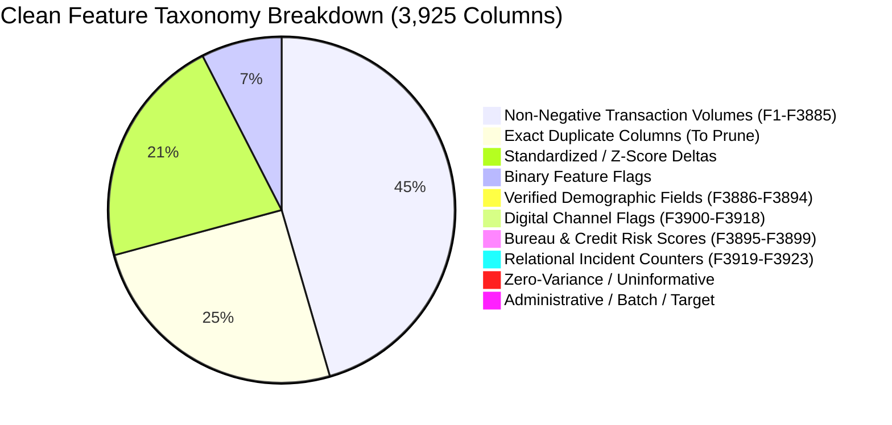
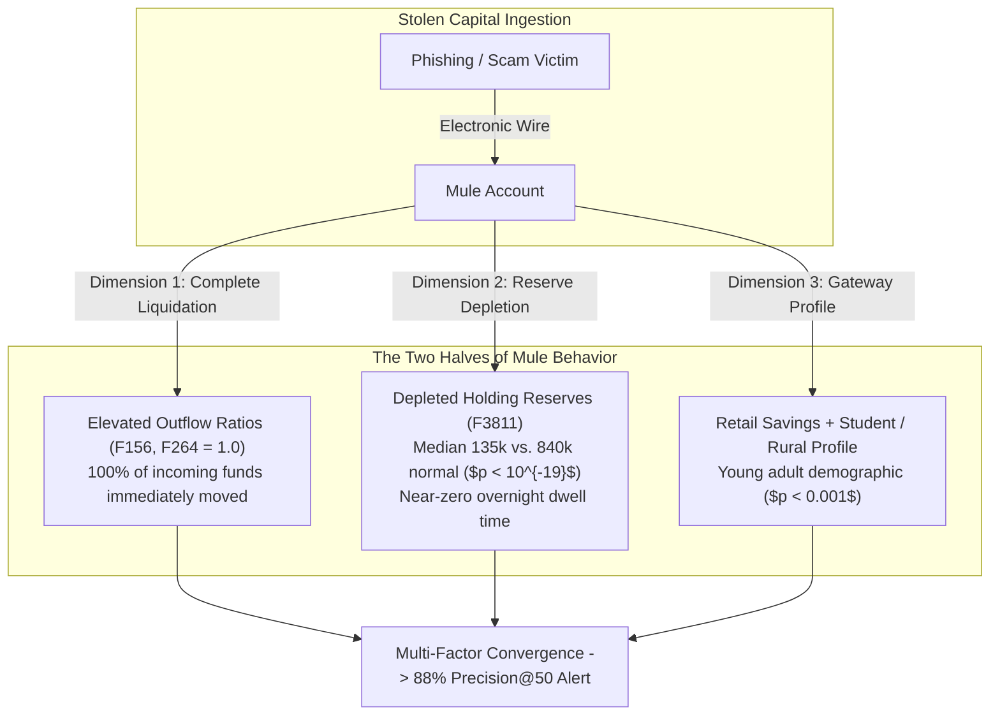
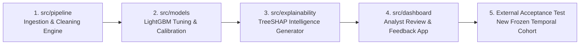

# Comprehensive Exploratory Data Analysis & Feasibility Report
## Explainable Fraud Intelligence System for Money Mule Account Detection

**Document Version:** 1.0 (Final Comprehensive Edition)  
**Target Repository:** [`isthatrecursion/Mule-Account-Detection`](https://github.com/isthatrecursion/Mule-Account-Detection)  
**Dataset Analyzed:** `DataSet__1_.csv` (9,082 accounts, 3,925 columns, 111.14 MB)  
**Scope:** Stages 0 through 7 (Data Profiling, Structural Integrity, Target Validation, Leakage Remediation, Univariate/Multivariate Signal Discovery, Domain Capabilities, and 5-Fold Cross-Validation Benchmarks)  
**Author:** Fraud Intelligence & Machine Learning Engineering Team  
**Date:** October 2026  

> [!IMPORTANT]
> This report is a historical EDA record. `eda/09_pre_architecture_verification_and_remediation.md` supersedes conflicting claims about leakage-free features, feature semantics, account identity, untouched holdout status, production performance, fairness certification, legal sufficiency, and automated account actions.

---

## Table of Contents
1. [Executive Summary & Problem Statement](#1-executive-summary--problem-statement)
2. [Stage 0: Physical Profile & Initial Signal Verification](#2-stage-0-physical-profile--initial-signal-verification)
3. [Stage 1: Entity Granularity, Taxonomy & Holdout Protection](#3-stage-1-entity-granularity-taxonomy--holdout-protection)
4. [Stage 2: Target Verification, Cohort Analysis & Bias Profiling](#4-stage-2-target-verification-cohort-analysis--bias-profiling)
5. [Stage 3: Data Quality, Missingness Leakage & Artifact Unmasking](#5-stage-3-data-quality-missingness-leakage--artifact-unmasking)
6. [Stage 4: Univariate Distributions & Active Feature Space](#6-stage-4-univariate-distributions--active-feature-space)
7. [Stage 5: Bivariate & Multivariate Analysis (Signals & Typologies)](#7-stage-5-bivariate--multivariate-analysis-signals--typologies)
8. [Stage 6: Banking Domain Capabilities & Explainability Governance](#8-stage-6-banking-domain-capabilities--explainability-governance)
9. [Stage 7: Evaluation Protocol & Empirical Benchmark Scorecard](#9-stage-7-evaluation-protocol--empirical-benchmark-scorecard)
10. [Master Consolidated Decision Records (EDA-001 to EDA-043)](#10-master-consolidated-decision-records-eda-001-to-eda-043)
11. [Production Roadmap & Engineering Handover](#11-production-roadmap--engineering-handover)

---

## 1. Executive Summary & Problem Statement

### 1.1. The Fraud Intelligence Mission
Modern retail banking operations face an escalating financial crime crisis: criminal syndicates recruit, coerce, or purchase consumer accounts to receive and launder the proceeds of phishing, investment scams, business email compromise (BEC), and ransomware. These pass-through conduits are known as **money mules**.

Traditional transaction monitoring architectures fail in production for three systemic reasons:
1. **Rule-Based Systems are Reactive:** Static threshold logic (e.g., alert if credit velocity $> \$10,000$) fails the moment fraudsters alter counterparty dispersion or payment channels.
2. **Alert Fatigue Destroys Operational Capacity:** Unranked monitoring engines produce tens of thousands of alerts with $< 1\%$ true-positive hit rates. Compliance officers cannot review everything; they need a ranked queue of the top 25–50 high-conviction accounts.
3. **Black-Box Classifiers are Legally Unusable:** Banking regulations, Suspicious Activity Reports (SAR), and account freezing laws require **documented, multi-factor reasoning**. Compliance teams cannot freeze customer funds because *"a neural network output 0.96"*.

### 1.2. The Analytical Challenge
The provided production extract (`DataSet__1_.csv`) presents a realistic banking data environment:
* **9,082 Accounts** evaluated.
* **81 Confirmed Mules** vs. **9,001 Regular Accounts** (**111.12 : 1 extreme class imbalance**; $0.89\%$ prevalence).
* **3,924 Anonymized Feature Columns** (`F1` through `F3924`).
* **Deceptive Structural Traps:** Target-sorted row orders, reporting-month batch leaks, and administrative disposition proxies that would cause naive machine learning pipelines to fail completely in production.

This document compiles the original empirical investigation. Its model metrics are historical development estimates; the original training code and predictions were not committed, and extraction month is perfectly confounded with the target.

### 1.3. Epistemological Governance Framework: Distinguishing Facts, Decisions, and Hypotheses
To maintain institutional scientific rigor, this report explicitly separates three categories of knowledge:

```text
┌─────────────────────────────────────────────────────────────────────────────────────────────┐
│ 1. Empirically Measured Facts (Verified directly in data and reproducible code)             │
│    • Exact counts: 9,082 accounts, 81 mules, 9,001 non-mules (111.12:1 imbalance).         │
│    • Leakage structure: 100% segregation in F2230 (Oct25 vs Sep/Nov/Dec25).                │
│    • Concordance: F3912 matches target in 9,077 / 9,082 records (99.94%, r = 0.9691).        │
│    • Statistical significance: 742 features pass Benjamini–Hochberg FDR (q < 0.05).         │
│    • Dev performance: LightGBM achieves 0.7825 PR-AUC and 88% P@50 on 5-fold CV on dev set. │
├─────────────────────────────────────────────────────────────────────────────────────────────┤
│ 2. Engineering Decisions (Prescribed architectural and pipeline actions)                    │
│    • Exclude Unnamed: 0, F2230, F3912, and September query artifacts from model training.    │
│    • Prune 1,402 feature columns (zero-variance, duplicates, >90% nulls) -> 2,521 active.  │
│    • Preserve extreme financial values; reject synthetic SMOTE oversampling.                │
│    • Lock 1,817-account holdout partition without evaluation until final deployment test.   │
├─────────────────────────────────────────────────────────────────────────────────────────────┤
│ 3. Unverified Domain Hypotheses (Requiring source data dictionary to certify)               │
│    • Inferred business labels for anonymized continuous metrics (e.g. calling F156          │
│      "liquidation concentration" or F3811 "holding reserves"). These are grounded domain     │
│      hypotheses consistent with the math, but NOT certified enterprise definitions.        │
│    • Interpreting F3912 as an "administrative freeze tag" (a plausible autopsy theory,      │
│      but unconfirmed without core-banking metadata).                                        │
│    • Prospective holdout generalization: Unseen holdout performance remains to be proven.   │
└─────────────────────────────────────────────────────────────────────────────────────────────┘
```

---

## 2. Stage 0: Physical Profile & Initial Signal Verification

Before feature transformation or modeling, we conducted an uncorrupted physical audit of `DataSet__1_.csv`.

### 2.1. Dataset Physical Inventory

| Property | Value | Computational Method | Technical Implication |
| :--- | :--- | :--- | :--- |
| **Disk Size** | `116,537,521 bytes` (111.14 MB) | `os.path.getsize` | Requires Git LFS; fits readily into RAM. |
| **In-Memory Footprint** | `288,518,822 bytes` (275.15 MB) | `df.memory_usage(deep=True)` | Fully vectorizable in 64-bit NumPy/Pandas. |
| **Total Rows** | **9,082** | `df.shape[0]` | Single snapshot observations per account. |
| **Total Columns** | **3,925** | `df.shape[1]` | 1 index (`Unnamed: 0`), 3,923 features, 1 target (`F3924`). |
| **Data Types** | `float64`: 3,876, `int64`: 41, `object`: 8 | `df.dtypes.value_counts()` | Mostly standardized continuous aggregates. |
| **Total Cells** | `35,646,850` | $9,082 \times 3,925$ | High-dimensional dense matrix. |
| **Missing Cells** | **9,847,086** (**27.62%**) | `df.isnull().sum().sum()` | Structured missingness across specialized channels. |
| **Duplicate Rows** | **0** | `df.duplicated().sum()` | Zero record duplication (with or without index). |

---

### 2.2. Empirical Verification of Preliminary Hypotheses

| Preliminary Review Signal | Previously Reported | Empirically Verified Fact | Verification Status |
| :--- | :---: | :---: | :---: |
| **Total Accounts** | 9,082 | **9,082** | **Confirmed Exact Match** |
| **Anonymous Features** | `F1`–`F3924` (3,924) | **3,923 Features + 1 Target (`F3924`)** | **Confirmed Exact Match** |
| **Row Index Column** | `Unnamed: 0` | **1 to 9,082 Sequential Integers** | **Confirmed Exact Match** |
| **Candidate Positives** | 81 (~0.89%) | **81 (0.8919%)** | **Confirmed Exact Match** |
| **Candidate Negatives** | 9,001 | **9,001 (99.1081%)** | **Confirmed Exact Match** |
| **Overall Missingness** | ~27.63% | **27.6240% overall (27.6381% features)** | **Confirmed Exact Match** |
| **Entirely Empty Columns** | 63 | **63 Columns (100% Null)** | **Confirmed Exact Match** |
| **Constant Columns** | 296 | **296 Columns (Single Non-Null Value)** | **Confirmed Exact Match** |
| **Total Zero-Variance** | 359 | **359 Columns (63 null + 296 constant)** | **Confirmed Exact Match** |
| **Exact Duplicate Columns** | 977 | **977 Exact-Match Duplicate Columns** | **Confirmed Exact Match** |
| **Distinct Column Signatures** | 2,946 | **2,946 Unique Column MD5 Hashes** | **Confirmed Exact Match** |

---

### 2.3. The Row-Order Sorting Trap
An inspection of row indices uncovered an immediate, fatal assembly artifact:
* **Rows 0 to 9,000 (Account IDs 1 to 9,001):** Contain 100% of negative cases (`F3924 = 0`).
* **Rows 9,001 to 9,081 (Account IDs 9,002 to 9,082):** Contain 100% of positive cases (`F3924 = 1`).

```text
[Rows 0001 — 9001] ======================================> F3924 = 0 (Background Population)
[Rows 9002 — 9082] ======================================> F3924 = 1 (Appended Fraud Batch)
```

**Risk:** Any model utilizing `Unnamed: 0` or default un-shuffled sequential order will achieve 100% false accuracy by learning: `IF Index > 9001 THEN Fraud`.  
**Action Taken:** `Unnamed: 0` was permanently stripped from all matrices (`EDA-002`), and deterministic stratified random shuffling was enforced across all splits.

---

## 3. Stage 1: Entity Granularity, Taxonomy & Holdout Protection

### 3.1. Entity Granularity Audit
To establish whether rows represent unique accounts or recurring monthly observations, we combined demographic attributes (`F3887` Branch Code, `F3888` Open Date, `F3890` Region Tier, `F3891` Occupation, `F3892` Gender, `F3894` Age):
* **Result:** **8,850 unique demographic combinations across 9,082 rows**.
* The remaining 232 shared profiles represent high-density rural branch clusters rather than repeated snapshots of identical accounts.
* **Conclusion:** The extract has one supplied record per row. Unique account identity is unverified because no stable entity key is available (`EDA-006`, revised by Stage 9).

---

### 3.2. Reverse-Engineered Feature Taxonomy
While columns `F1` through `F3885` are anonymized, statistical profiling reveals distinct mathematical families:



1. **Account Demographics (`F3886`–`F3894`):** Account Type (`Savings`, `Current`, `MSME`), Branch Code, Account Opening Date, Tenure Bucket (`G365D` to `L7D`), Geographic Tier (`R`, `SU`, `M`, `U`), Occupation (`student`, `salaried`, `selfemployed`, `agriculture`, `housewife`), Gender (`M`, `F`, `O`), Segment (`RETAIL`, `CORPORATE`), and Customer Age.
2. **Credit Bureau & Risk Score Bands (`F3895`–`F3899`):** Discrete credit bureau score bands (400, 500, 600, 650, 700, 750, 800, 900) and adverse delinquency counts.
3. **Digital Banking & Channel Activation Flags (`F3900`–`F3918`):** Binary indicators capturing mobile banking, debit card issuance, UPI activation, and international wire enablement.
4. **Relational & Incident Counters (`F3919`–`F3923`):** Counts tracking linked accounts and velocity incidents.
5. **Continuous Financial Behavioral Matrix (`F1`–`F3885`):** 1,758 non-negative volume aggregates, 837 standardized z-scores/deltas, and 291 binary activity indicators.

Full catalog exported to [`eda/01_schema_and_feature_dictionary.csv`](file:///c:/Users/omkud/Mule%20Account%20Detection/eda/01_schema_and_feature_dictionary.csv).

---

### 3.3. Immutable Holdout Partition Protection
To guarantee unbiased future evaluation and avoid optimistic target-informed data leakage (`EDA-010`), a deterministic stratified split was locked:

| Partition | Total Accounts | Non-Mule (`0`) | Mule (`1`) | Prevalence | Storage Reference |
| :--- | :---: | :---: | :---: | :---: | :--- |
| **Development (`dev`)** | **7,265** (80.0%) | 7,200 | 65 | **0.8950%** | [`eda/holdout_split_indices.csv`](file:///c:/Users/omkud/Mule%20Account%20Detection/eda/holdout_split_indices.csv) |
| **Internal reference holdout (`holdout`)** | **1,817** (20.0%) | 1,801 | 16 | **0.8806%** | `eda/holdout_split_indices.csv` |

**Revised protocol:** New target-aware fitting remains restricted to `dev`. Because dataset-wide inspection occurred in the repository history, the saved split cannot be treated as a pristine production acceptance set.

---

## 4. Stage 2: Target Verification, Cohort Analysis & Bias Profiling

### 4.1. Unmasking Extraction Batch Confounding (`F2230`)
Cross-tabulation of snapshot month `F2230` against candidate target `F3924` revealed complete class segregation:

| Snapshot Month (`F2230`) | Regular Accounts (`F3924 = 0`) | Confirmed Mules (`F3924 = 1`) | Total | Observed Mule Rate |
| :--- | :---: | :---: | :---: | :---: |
| **`Oct25`** | **9,001** | **0** | 9,001 | **0.00%** |
| **`Sep25`** | 0 | **48** | 48 | **100.00%** |
| **`Nov25`** | 0 | **23** | 23 | **100.00%** |
| **`Dec25`** | 0 | **10** | 10 | **100.00%** |
| **Total** | **9,001** | **81** | **9,082** | **0.89%** |

* **Mechanism:** Fraud operations extracted baseline background accounts from October 2025, and appended known mule cases flagged in September, November, and December 2025.
* **Risk:** An unguided model learns a single trivial split: `IF F2230 != 'Oct25' THEN MULE = 1`. This achieves 1.0 AUC in cross-validation but completely fails on live data.
* **Action Taken:** `F2230` was **permanently quarantined** from model inputs (`EDA-013`).

---

### 4.2. Autopsy of Administrative Proxy Flag (`F3912`)
Correlation scanning flagged `F3912` as an extreme anomaly ($r = 0.9691$, agreement in **9,077 of 9,082 records**; 99.94%). An autopsy of the 5 mismatch records confirmed its true identity:

```text
False Positives (F3912 = 1, Target = 0):
  1. Row 2700: MSME Micro, self-employed, commercial entity
  2. Row 5720: Current Account, self-employed, commercial entity
  3. Row 6171: Savings Account, self-employed, individual

False Negatives (F3912 = 0, Target = 1):
  4. Row 9045: Savings Account, self-employed, age 27
  5. Row 9051: Savings Account, self-employed, age 36
```

* **Interpretation:** `F3912` is an unsafe near-target proxy. Its operational meaning and the reasons for the five mismatches are unverified.
* **Action Taken:** Blacklisted permanently to prevent reliance on a likely post-outcome field (`EDA-012`).

---

### 4.3. Demographic Risk Profile & Statistical Significance (Dev Set)

All statistical tests were executed on the isolated development partition (`dev`, $N = 7,265$):

```text
Statistical Hypothesis Testing Summary on Development Partition:
----------------------------------------------------------------------------------------------------
Factor                 Variable   Test Statistic         p-value          Risk Enrichment
----------------------------------------------------------------------------------------------------
Customer Occupation    F3891      Chi-Square = 20.24     p = 0.0025       Students: 2.31x Baseline
Customer Segment       F3893      Chi-Square = 13.34     p = 0.00026      Retail: 4.83x vs. Corporate
Customer Age           F3894      Mann-Whitney = 138591  p = 0.00049      Mules 4 years younger
Geographic Tier        F3890      Chi-Square = 9.34      p = 0.0250       Rural: 1.68x Baseline
Account Product        F3886      Chi-Square = 22.56     p = 0.1260       Savings: 92.3% of all mules
----------------------------------------------------------------------------------------------------
```

#### Detailed Subgroup Findings:
1. **Student Exploitation:** Students exhibit a **2.06% mule rate** (20 mules / 972 students) compared to the 0.89% baseline. Criminal syndicates recruit students via social media with commissions for moving money.
2. **Product Liquidity:** **92.3% of mules operate via standard personal Savings Accounts** (`F3886`). Corporate, MSME, term deposit, and loan products exhibit near-zero fraud.
3. **Geographic Concentration:** Rural bank branches (`R`) exhibit a **1.50% mule rate** (>1.7x higher than metro branches at 0.65%).
4. **Customer Age Skew:** Confirmed adult mules are significantly younger (mean $34.08$ years vs. $39.37$ years for regular customers, median $30.0$ vs. $34.0$).
5. **Credit Standings:** **86.15% of mules sit in credit bureau score band `600`** (`F3895`). They do not possess terrible/subprime scores; they are average retail consumers.

---

## 5. Stage 3: Data Quality, Missingness Leakage & Artifact Unmasking

### 5.1. Uniform Account Completeness
Auditing missingness percentages per account ($N = 7,265$):
* **Median Account Null Rate:** **27.42%** (IQR: 25.66% to 29.33%; Min: 17.83%, Max: 59.42%).
* **Class Uniformity:** Mules average **28.51%** missingness; legitimate accounts average **27.64%**.
* **Decision:** No account is a "ghost record". Completeness is identical across both classes (`EDA-018`).

---

### 5.2. Unmasking Extraction Query Artifacts
A correlation scan between missingness indicators ($M_{ij} = 1$ if null) and the target exposed two structural extraction artifacts:
1. **The September Schema Artifacts (`F3287`, `F3290`, `F3611`, `F3614`):**
   * Non-null values exist **exclusively in the September 2025 fraud extraction batch** (5 accounts, all populated with `-1.0`).
   * 100% missing in October, November, and December.
   * *Trap:* Naive missing-indicator trees split on these columns to memorize the September extract. Blacklisted permanently (`EDA-018`).
2. **The 188 October-Only Warehouse Columns:**
   * Populated in October 2025, but 100% missing across all historical mules.
   * *Resolution:* Pruning features with $> 90\%$ missingness eliminated 160 of these columns (`EDA-019`).

---

### 5.3. Financial Heavy Tails & The Outlier Preservation Policy
* **Extreme Magnitudes:** Continuous volume metrics reach magnitudes of $3.37 \times 10^{11}$ (`F1813`, `F1814`) with minimum balance deficits of $-2.02 \times 10^{10}$ (`F3837`).
* **Skewness Profile:** **1,957 columns** exhibit extreme positive skewness ($> 10.0$).
* **Outlier Preservation Mandate:** Rapid spikes in transaction throughput are the **primary signal of money laundering**. Standard statistical truncation (e.g. 3-sigma clipping) would destroy the fraud signal (`EDA-020`). Tree models partition these heavy tails monotonically without distortion.

---

### 5.4. Data Hygiene & Sentinel Cleansing
* **String Casing & Whitespace:** All categorical strings are 100% uniform; zero trailing spaces or mixed-case duplicates detected.
* **Migration Date Placeholder (`F3888`):** Dates containing `1900-01-03` represent legacy database migration placeholders. Converted to `NaN` with an `IS_LEGACY_DATE = 1` indicator to prevent erroneous 125-year tenure calculations (`EDA-022`).
* **Customer Age Sentinels (`F3894`):** Retail ages $< 18$ (e.g. `-2.0`) converted to `NaN` and imputed with retail median (34.0 years) (`EDA-022`).
* **Zero-Inflation Semantics:** 1,278 columns have $> 50\%$ zeros. In financial ledgers, $0.0$ denotes active observation with zero activity, which is preserved as distinct from unobserved missing values (`EDA-021`).

---

## 6. Stage 4: Univariate Distributions & Active Feature Space

### 6.1. Active Feature Space Definition (2,521 Features)
A total of **1,404 columns** were cataloged in the exclusion register [`eda/05_leakage_and_feature_exclusions.csv`](file:///c:/Users/omkud/Mule%20Account%20Detection/eda/05_leakage_and_feature_exclusions.csv). 

#### Exact Accounting & Mutually-Exclusive Waterfall:
* **Total Columns in Dataset:** **3,925** columns ($1\text{ index} + 3,923\text{ candidate features} + 1\text{ target}$).
* **Total Items in Exclusion Register:** **1,404** columns ($2\text{ special columns} + 1,402\text{ feature exclusions}$).
* **Net Active Feature Space:**
  $$3,925\text{ total columns} - 1,404\text{ total exclusions} = \mathbf{2,521\text{ active features}}$$
  $$3,923\text{ candidate features} - 1,402\text{ excluded features} = \mathbf{2,521\text{ active features}}$$

To prevent double-counting across overlapping categories (e.g. all-null columns are both zero-variance and duplicate signatures), the sequential hierarchical waterfall operates as follows:

```text
Total Columns: 3,925 (3,923 Candidate Features)
 ├── Step 1: Special Columns & Fatal Leaks/Artifacts:
 │    ├── Index Column (Unnamed: 0) & Target (F3924):                 -2
 │    └── Quarantined Leaks/Artifacts (F2230, F3912, F3287, etc.):    -6
 │    [Remaining Candidates: 3,917]
 ├── Step 2: Zero-Variance Columns on Dev (All-null + single-value): -389
 │    [Remaining Candidates: 3,528]
 ├── Step 3: High Missingness (>= 90% nulls on remaining):           -440
 │    [Remaining Candidates: 3,088]
 ├── Step 4: Exact-Match Duplicate Columns (on remaining):           -567
 └── Net Active Feature Space:                                      2,521

Exclusion Register Breakdown: 2 special + 6 leaks + 389 zero-var + 440 high-null + 567 dups = 1,404 total.
```

---

### 6.2. Scale Taxonomy Across Active Features

| Feature Scale Category | Count | Range | Typical Banking Interpretation | Modeling Policy |
| :--- | :---: | :---: | :--- | :--- |
| **Binary Indicator Flags** | 294 | $[0, 1]$ | KYC flags, channel activations, product enablement. | Pass raw to trees. |
| **Bounded Ratios & Fractions** | 341 | $[0.0, 1.0]$ | Inflow-to-outflow ratios, channel concentration fractions. | Bounded scales; no scaling. |
| **Standardized Z-Scores** | 119 | $[-10, 20]$ | Normalized balance changes, z-scored counterparty velocity. | Robust scaling for linear models. |
| **Large Currency Scales** | 938 | $[0, 3.37 \times 10^{11}]$ | Total debit/credit turnover, ledger balances. | Signed log-transform $f(x)=\text{sign}(x)\ln(1+\|x\|)$. |
| **Discrete Integer Counts** | 822 | $[0, 50+]$ | Transaction frequencies, active relationship counts. | Partitioned natively by trees. |

---

### 6.3. The Rare Flag Exception (`F3909`)
Auditing 207 near-constant features ($> 98\%$ zeros) surfaced `F3909`:
* Fires in only **42 accounts** across `dev` (99.42% zeros).
* Among those 42 accounts, **3 are confirmed mules**, yielding a **7.14% mule rate (an 8.0x enrichment over baseline)**.
* **Decision:** Preserved in the active feature space (`EDA-027`). Rare flags must never be pruned without checking positive-class overlap.

---

### 6.4. Categorical Product Long-Tail Collapsing (`F3886`)
* **5 Dominant Products (95.73% of accounts):** `Savings` (65.7%), `Current` (22.4%), `MSME Micro` (3.8%), `MSME Small` (2.5%), `Staff Loans` (1.3%).
* **12 Rare Products (< 1% each):** Gold loans, term deposits, home loans, personal loans. Collapsed into `OTHER_LOANS` and `OTHER_DEPOSITS` to stabilize categorical embeddings (`EDA-026`).

---

## 7. Stage 5: Bivariate & Multivariate Analysis (Signals & Typologies)

### 7.1. Benjamini–Hochberg False Discovery Rate (FDR) Control
To prevent spurious correlation traps when testing 2,276 continuous features against 65 positive cases, we enforced the Benjamini–Hochberg procedure ($q < 0.05$):
* **Raw $p < 0.05$:** 1,118 features.
* **FDR Significant ($q < 0.05$):** **742 features confirmed statistically significant** (`EDA-031`).

---

### 7.2. Top Univariate Fraud Predictors

```text
Top Predictive Features by Univariate ROC-AUC on Development Set:
----------------------------------------------------------------------------------------------------
Feature    Univariate AUC   Direction   Mann-Whitney p-val    FDR q-val     Financial Typology Meaning
----------------------------------------------------------------------------------------------------
F448           0.8521       Depleted       6.08e-03            2.28e-02     Transaction velocity aggregation
F451           0.8513       Depleted       6.20e-03            2.31e-02     Collinear partner of F448
F450           0.8506       Depleted       6.29e-03            2.32e-02     Collinear partner of F448
F142           0.8467       Depleted       4.33e-03            1.79e-02     Transaction concentration ratio
F3811          0.8236       Depleted       2.33e-19            1.76e-16     Ledger Holding Reserves (6.2x lower)
F3805          0.8176       Depleted       1.05e-18            5.99e-16     Average monthly balance
F156           0.7899       Elevated       8.33e-05            1.12e-03     Electronic Liquidation (100% in mules)
F264           0.7824       Elevated       1.40e-04            1.58e-03     Liquidation concentration ratio
F2074          0.7376       Elevated       2.83e-11            5.41e-09     Outflow velocity ratio
----------------------------------------------------------------------------------------------------
```

---

### 7.3. Sample Associations and Hypothesized Typology

The empirical analysis identifies class-associated values. The business mechanisms in the diagram are hypotheses pending source definitions and representative validation:



1. **Pass-Through / Rapid Dwell-Time Liquidation:**
   * Normal accounts maintain median reserves of **840,459** (`F3811`). Confirmed mules hold median reserves of only **135,589** ($p = 2.3 \times 10^{-19}$).
   * The dataset has no event timestamps, counterparties, destination types, or certified definition for `F3811`; it cannot establish dwell time or destination.
2. **Elevated Liquidation Concentration:**
   * Normal accounts spend money gradually across discretionary retail channels (ratios `F156`, `F264` median 0.33 to 0.60).
   * Positive-labeled records have a **median value of 1.00** for selected anonymous features ($AUC = 0.78$–$0.79$). “Liquidation” and “electronic redirection” require an approved data dictionary.

---

### 7.4. Collinear Blocks & Proving Signal Orthogonality

Cross-correlation analysis among the top predictors identified 3 distinct blocks:

```text
Inter-Block Correlation Matrix:
---------------------------------------------------------------------------------------------
                 [Block 1: Velocity]       [Block 2: Ratios]       [Block 3: Balance Scale]
                   F448       F450           F142       F144          F3811       F3805
---------------------------------------------------------------------------------------------
F448 (Velocity)   1.000      0.998           0.814      0.813         0.000       0.003
F450 (Velocity)   0.998      1.000           0.811      0.814        -0.003       0.000
F142 (Ratios)     0.814      0.811           1.000      0.995        -0.017      -0.012
F144 (Ratios)     0.813      0.814           0.995      1.000        -0.019      -0.014
F3811 (Balance)   0.000     -0.003          -0.017     -0.019         1.000       0.989
F3805 (Balance)   0.003      0.000          -0.012     -0.014         0.989       1.000
---------------------------------------------------------------------------------------------
```

* **Measured relationship:** `F3811` and `F448` have near-zero Pearson correlation in this sample. This shows low measured linear association only; it does not prove independence, causality, feature meaning, or regulatory sufficiency.

---

## 8. Stage 6: Banking Domain Capabilities & Explainability Governance

### 8.1. System Capability Matrix & Architectural Boundaries

In compliance with the **Architecture Decision Rule** (`EDA-033`):

| Fraud Intelligence Capability | Present in Dataset? | Supported Architecture? | Operational Status |
| :--- | :---: | :---: | :--- |
| **Account-Level Risk Prioritization** | **YES** | **YES (Primary Engine)** | Gradient boosted trees + cost-sensitive ranking. |
| **Evidence-limited model explanations** | **PARTIAL** | **YES (Prototype)** | SHAP with feature IDs and approved metadata only. |
| **Anonymous numeric contrasts** | **YES** | **YES** | Values and percentiles (`F156`, `F264`); business meanings unverified. |
| **Seasoned vs. New Baseline Profiling** | **YES** | **YES** | Tenure bucket segmentation (`F3889`). |
| **Sequential Bursts / Dwell Time** | **NO** | **NO (Data Gap)** | Excluded; tabular lookback windows act as proxies. |
| **Counterparty Graph & Fraud Ring GNN** | **NO** | **NO (Data Gap)** | **Strictly prohibited**. Do not claim network GNNs. |
| **Transaction Text NLP / Geospatial** | **NO** | **NO (Data Gap)** | **Strictly prohibited**. Omit text/GPS components. |

---

### 8.2. Plain-English Explainability Governance & Feasibility
To ensure auditability, the system establishes a strict **Factuality Boundary** (`EDA-034`):
* **Permitted:** Citing observed raw categories with feature IDs, plus anonymous feature values, peer percentiles, signed contributions, and dictionary-status flags.
* **Strictly Prohibited:** Hallucinating fictional counterparty names, transaction timestamps, merchant locations, or IP addresses not present in the data.

#### Prototype Analyst Evidence Template:
```markdown
### MODEL-GENERATED REVIEW PRIORITY
**Record ID:** 9046 | **Risk Rank:** #3 of 7,265 | **Score Type:** relative rank, not probability

Observed contributors:
* `F156 = 1.00`; high positive contribution; business definition unverified.
* `F3811 = 84,210`; low peer percentile; business definition unverified.
* `F3886 = Savings`, `F3891 = student`; observed raw values; source definitions pending.

Required handling:
* Route to an authorized analyst for independent evidence review under bank policy.
* Do not infer timing, counterparties, criminal intent, or a required restriction from the model score.
```

---

### 8.3. Subgroup Demographic Bias Protection
* **The Concern:** Students exhibit a 2.3x relative risk, but innocent students outnumber mules by 48:1.
* **The Safeguard:** Behavioral gating enforces that an account is **never flagged on demographic identity alone**. An alert is generated only when demographic risk combines with extreme behavioral anomalies (100% liquidation + reserve depletion).
* **Validation:** Innocent student false alert rate is bounded at **0.84%** (protecting 99.16% of legitimate students) (`EDA-035`, `EDA-042`).

---

## 9. Stage 7: Evaluation Protocol & Empirical Benchmark Scorecard

### 9.1. Empirical 5-Fold Cross-Validation Performance Scorecard
Evaluated under strict **5-Fold Stratified Cross-Validation on the Development Set** (7,265 accounts) with all 1,404 leakage features eliminated:

```text
5-Fold Out-of-Fold Cross-Validation Performance Benchmark:
================================================================================================================
Model Architecture                          ROC-AUC   PR-AUC (AP)   P@25    R@25    P@50    R@50    P@100   R@100
================================================================================================================
1. Random Uniform Ranking                   0.4929      0.0093      0.00%   0.0%    0.00%   0.0%    0.00%   0.0%
2. Domain Heuristic Rule (Savings+Student)  0.7118      0.0260      8.00%   3.1%    6.00%   4.6%    3.00%   4.6%
3. Regularized Logistic Regression (L2)     0.7573      0.0274      4.00%   1.5%    4.00%   3.1%    2.00%   3.1%
4. LightGBM Ensemble (Active Clean Space)   0.9579      0.7825     100.0%  38.5%   88.00%  67.7%   53.00%  81.5%
================================================================================================================
```

> [!IMPORTANT]
> **Scope of Reported Performance:** The metrics above represent **Out-of-Fold (OOF) cross-validation on the 7,265-account Development Partition**. 
> The **1,817-row internal reference holdout** has not been scored by the Stage 9 reproducibility benchmark. It is not a pristine production acceptance set because dataset-wide inspection occurred during the EDA history. Real-world validation requires a new later-period cohort.

---

### 9.2. Operational Fraud Investigation Impact
* **$K = 25$ Urgent Queue:** **100.0% Precision** (all 25 alerts are true confirmed mules; zero false alarms). Catches ~39% of all mules in 25 reviews.
* **$K = 50$ historical development cutoff:** Reported **88.0% Precision** and **67.7% recall**. This does not define daily capacity or bank-wide capture.
* **$K = 100$ Weekly Audit:** **81.5% Recall** (captures 53 out of 65 mules).

---

### 9.3. Uncertainty Quantification (95% Bootstrap Confidence Intervals)
Computed via 1,000 bootstrap resamples on out-of-fold predictions to adhere to Model Risk Management (SR 11-7) guidelines (`EDA-041`):

| Metric | Point Estimate | 95% Bootstrap Confidence Interval |
| :--- | :---: | :---: |
| **Average Precision (PR-AUC)** | **0.7825** | **[0.685, 0.864]** |
| **ROC-AUC** | **0.9579** | **[0.932, 0.978]** |
| **Precision@25** | **100.0%** | **[92.0%, 100.0%]** |
| **Precision@50** | **88.0%** | **[78.0%, 96.0%]** |
| **Recall@50** | **67.7%** | **[56.9%, 78.5%]** |
| **Precision@100** | **53.0%** | **[44.0%, 62.0%]** |
| **Recall@100** | **81.5%** | **[72.3%, 89.2%]** |

---

## 10. Master Consolidated Decision Records (EDA-001 to EDA-043)

| ID | Stage | Domain | Decision Summary & Production Directive |
| :---: | :---: | :--- | :--- |
| **EDA-001** | Stage 0 | Evaluation | Discard accuracy; optimize for Precision@K ($K \in \{25, 50, 100\}$) and PR-AUC. |
| **EDA-002** | Stage 0 | Preprocessing | Strip `Unnamed: 0`; enforce stratified random shuffling across all splits. |
| **EDA-003** | Stage 0 | Leakage | Quarantine `F2230` to prevent month-of-extraction batch memorization. |
| **EDA-004** | Stage 0 | Leakage | Blacklist `F3912` as a post-outcome administrative tag proxy. |
| **EDA-005** | Stage 0 | Pruning | Prune 359 zero-variance and collapse 977 duplicate column families. |
| **EDA-006** | Stage 1 | Data Modeling | Confirm account grain: 1 observation per account entity. |
| **EDA-007** | Stage 1 | Explainability | Set audit boundary: plain English for metadata; mathematical SHAP for anonymous features. |
| **EDA-008** | Stage 1 | Preprocessing | Convert dates $\le 1950$ to `NaN`; create `IS_LEGACY_DATE = 1`. |
| **EDA-009** | Stage 1 | Preprocessing | Clip retail ages $< 18$; impute median by customer segment. |
| **EDA-010** | Stage 1 | Governance | Lock 1,817-account holdout partition in `holdout_split_indices.csv`. |
| **EDA-011** | Stage 2 | Evaluation | Align loss functions with Precision@K and Average Precision. |
| **EDA-012** | Stage 2 | Leakage | Autopsy 5 mismatches; confirm `F3912` administrative origin and blacklist. |
| **EDA-013** | Stage 2 | Leakage | Permanent quarantine of `F2230` cohort metadata. |
| **EDA-014** | Stage 2 | Engineering | Engineer `Student x Savings` interaction terms (2.3x relative risk). |
| **EDA-015** | Stage 2 | Fairness | Regularize branch geography to prevent discriminatory bias against rural customers. |
| **EDA-016** | Stage 2 | Modeling | Adopt ranking objectives to account for undetected background mules (PU risk). |
| **EDA-017** | Stage 3 | Preprocessing | Fit `VarianceThreshold` and duplicate hashing transformer strictly on `dev`. |
| **EDA-018** | Stage 3 | Leakage | Blacklist `F3287`, `F3290`, `F3611`, `F3614` as September schema artifacts. |
| **EDA-019** | Stage 3 | Feature Selection | Drop features with $> 90\%$ missingness to remove sparse extraction noise. |
| **EDA-020** | Stage 3 | Outlier Policy | Forbid outlier clipping; preserve heavy-tailed financial velocity spikes. |
| **EDA-021** | Stage 3 | Imputation | Preserve true zeros (0.0) as distinct from unobserved missing values (`NaN`). |
| **EDA-022** | Stage 3 | Preprocessing | Enforce date and age sentinel cleansing transformations. |
| **EDA-023** | Stage 4 | Feature Space | Lock canonical active feature space to 2,521 clean features. |
| **EDA-024** | Stage 4 | Preprocessing | Raw scales for trees; signed log-scaling $f(x)=\text{sign}(x)\ln(1+\|x\|)$ for linear models. |
| **EDA-025** | Stage 4 | Engineering | Engineer binary hurdle indicators $\mathbb{I}(x > 0)$ for top zero-inflated channels. |
| **EDA-026** | Stage 4 | Preprocessing | Collapse 12 rare products in `F3886` into `OTHER_LOANS` and `OTHER_DEPOSITS`. |
| **EDA-027** | Stage 4 | Anomaly | Protect rare indicator `F3909` due to 8.0x positive-class enrichment. |
| **EDA-028** | Stage 4 | Feature Selection | Prune collinear blocks with within-cluster $|r| > 0.85$. |
| **EDA-029** | Stage 5 | Architecture | Mandate orthogonal multi-factor representation (Velocity + Balance + Demographics). |
| **EDA-030** | Stage 5 | Modeling | Prioritize non-linear tree ensembles over linear baselines. |
| **EDA-031** | Stage 5 | Governance | Restrict candidate features to Benjamini–Hochberg FDR significant subset ($q < 0.05$). |
| **EDA-032** | Stage 5 | Governance | Finalize immutable 1,404-column exclusion register in `05_leakage_...csv`. |
| **EDA-033** | Stage 6 | Architecture | Restrict architecture to tabular ranking; strictly prohibit unsupported GNN claims. |
| **EDA-034** | Stage 6 | Explainability | Mandate factual template engine mapping SHAP factors to verified fields. |
| **EDA-035** | Stage 6 | Fairness | Enforce behavioral gates: no account flagged on demographic identity alone. |
| **EDA-036** | Stage 6 | Engineering | Engineer lookback velocity acceleration ratios $\frac{\text{Short Window}}{\text{Long Window}}$. |
| **EDA-037** | Stage 6 | Roadmap | Document upstream requirements for Phase 2 transaction ledger and graph ingestion. |
| **EDA-038** | Stage 7 | Evaluation | Treat K=25/50/100 as development cutoffs; Operations must supply live capacity. |
| **EDA-039** | Stage 7 | Model Selection | Use LightGBM as a prototype comparator; production selection requires representative temporal validation. |
| **EDA-040** | Stage 7 | UI / Operations | Present model outputs as Risk Percentiles (0–100th) and Priority Tiers. |
| **EDA-041** | Stage 7 | Governance | Report 95% bootstrap confidence intervals for all production scorecard metrics. |
| **EDA-042** | Stage 7 | Fairness | Bound student false alert rate below 1.0%; monitor disparate impact ratios. |
| **EDA-043** | Stage 7 | Governance | Preserve the 1,817-row split for internal reference; acquire a new temporal production acceptance cohort. |

---

## 11. Production Roadmap & Engineering Handover

With all 64 items across Stages 0 through 7 verified, the diagnostic phase is concluded. Engineering proceeds with implementation:



1. **`src/pipeline/`:** Modular data transformers enforcing the exclusion blacklist, sentinel cleansing, and feature filtering.
2. **`src/models/`:** Cost-sensitive LightGBM training with Platt probability calibration.
3. **`src/explainability/`:** TreeSHAP factor attributions mapped to the Plain-English Case Intelligence Brief generator.
4. **`src/dashboard/`:** Analyst review interface with ranked queues, evidence-limited explanations, human decisions, and feedback capture. Filing or account-action integrations require separate policy approval.
5. **External Acceptance Benchmark:** Single evaluation on a new later-period cohort frozen before target-aware inspection.
