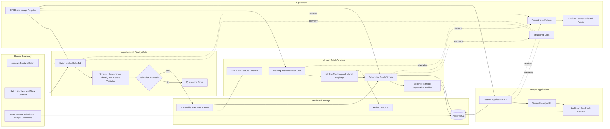

# Mule Account Risk Ranking — System Architecture

**Status:** Buildable controlled-prototype architecture

**Architecture scope:** Batch risk ranking and analyst review; no automated account action

**Source of truth for data limitations:** `eda/09_pre_architecture_verification_and_remediation.md`

**Timeboxed implementation:** [`02_complete_solution_14h_execution_plan.md`](02_complete_solution_14h_execution_plan.md) preserves this complete architecture while packaging the first end-to-end vertical slice for a 13–14 hour AI-assisted build.

**Delayed transaction resilience:** [`03_delayed_transaction_resilience.md`](03_delayed_transaction_resilience.md) defines the event contract, ten-minute durable buffer, freshness states, targeted reconciliation path, and measurable 95% consistency / 5% processing-overhead gates for a future transaction feed.

## Assumptions

This document describes the target controlled-prototype architecture and its production-hardening path. The immediate 13–14 hour build is defined separately. Longer-term planning assumptions are:

- one developer working for 8–10 weeks;
- a controlled prototype for fraud analysts and ML reviewers;
- Docker deployment on one Linux VM or an equivalent on-premises server;
- one scheduled batch per day, configurable rather than hard-coded;
- approximately 10,000 records per batch initially, with a practical design target of 100,000;
- confidential financial data, internal-network access, and human approval for every adverse action;
- no production promotion until the Stage 9 data and validation gates pass.

If the target is an internal bank pilot or production candidate, the same component boundaries remain useful, but identity integration, high availability, disaster recovery, and formal compliance controls move into the first release.

## 1. Requirements

### Project goal and users

Build an explainable batch risk-ranking system that prioritizes account records for fraud analysts, presents traceable model evidence, records analyst outcomes, and supports reproducible model development.

Primary users:

- **Fraud analyst:** reviews a ranked queue, inspects evidence, and records disposition.
- **ML engineer/model reviewer:** trains, compares, validates, and promotes model versions.
- **Data/platform operator:** ingests batches, investigates validation failures, and monitors jobs.
- **Compliance/model-risk reviewer:** audits lineage, explanations, access, and human decisions.

### EDA constraints that directly shape the design

| EDA finding | Architectural consequence |
|---|---|
| 9,082 rows, 3,925 columns, approximately 275 MB in memory | A single-machine pandas/LightGBM pipeline is sufficient initially; distributed compute is unnecessary. |
| 81 positives and 111:1 imbalance | Optimize ranking metrics and uncertainty; never use accuracy as the primary gate. |
| Target and extraction month are perfectly confounded | Add a dataset promotion gate; current metrics are diagnostic and cannot approve production use. |
| 1,404 registered exclusions and 2,521 candidate columns | Store a versioned feature policy and fail scoring on schema or policy mismatch. |
| 504 retained columns have at least a 10-point missingness gap | Monitor missingness by source/time cohort and block promotion on unexplained divergence. |
| Anonymous feature semantics | Explanations use feature ID, value, percentile, contribution, and dictionary status. |
| No transaction events, timestamps, or graph edges in the current dataset | Keep the current scorer batch-based. Require the delayed-data contract and reconciliation design before connecting a future transaction feed; omit graph detection until edge data exists. |
| Existing 20% split is internal reference only | Require a new frozen temporal acceptance cohort before production promotion. |
| No verified stable account ID | Make a stable pseudonymous `account_id` mandatory in the production data contract. |

### Functional requirements

1. Accept a versioned account-feature batch plus manifest.
2. Validate schema, provenance, timestamps, feature policy, and row identity before processing.
3. Quarantine invalid batches with machine-readable failure reasons.
4. Apply the exact preprocessing bundle stored with the selected model.
5. Generate a ranked review queue with score percentile, model version, and data version.
6. Generate evidence-limited explanations for the top configured `K` records.
7. Let analysts filter, inspect, assign, comment, and record a disposition.
8. Keep an append-only audit trail for scoring runs, model versions, and analyst actions.
9. Train and compare a transparent baseline and LightGBM using fold-safe pipelines.
10. Register model artifacts only after automated validation; require human approval for promotion.
11. Track data quality, score drift, job health, analyst outcomes, and delayed-label performance.
12. Export investigation data for authorized downstream review without initiating holds or filings.

### Non-functional requirements

| Area | Prototype target | Production gate |
|---|---|---|
| Ranking quality | Reproduce development diagnostics; report AP, ROC-AUC, P@K, R@K, lift, counts, and fold variance. | Meet thresholds agreed with Fraud Operations on a new representative temporal cohort. |
| Batch latency | Score 10,000 records in under 15 minutes on one VM. | Set from actual data arrival and analyst service levels. |
| UI/API latency | Queue and case-detail reads p95 under 500 ms on the internal network. | Load-test against measured concurrent users. |
| Availability | Recoverable single-node service during business hours. | Define SLA, redundancy, RPO, and RTO for the pilot. |
| Scalability | Up to 100,000 records per scheduled batch without redesign. | Move storage and workers horizontally when volume or SLA requires it. |
| Explainability | Every score exposes traceable inputs and signed contributions; anonymous meanings remain unexpanded. | Compliance approves vocabulary and evidence requirements. |
| Security | Private network, TLS when shared, RBAC, encrypted disks/backups, secret isolation, audit log. | Organization security review, SSO, key management, retention, and incident response. |
| Reproducibility | Record input hashes, code revision, dependencies, configuration, folds, predictions, metrics, and artifact checksum. | CI must reproduce approved runs within documented tolerances. |

## 2. High-Level Architecture



The scorer is a scheduled worker, not a public real-time model endpoint. The API serves persisted queues, evidence, and analyst workflow. This keeps model execution reproducible and avoids pretending that the snapshot data supports real-time transaction blocking.

## 3. Component Design

| Component | Responsibility | Inputs → outputs | Recommended technology | Alternative and trade-off |
|---|---|---|---|---|
| Batch intake | Accept files and manifests, calculate checksums, assign batch ID, prevent duplicate ingestion. | CSV/Parquet + JSON manifest → immutable batch record | Python CLI invoked by host scheduler or CI job | Prefect adds retries and orchestration UI, but adds another service before workflow complexity justifies it. |
| Data-contract validator | Validate required columns, types, unique account IDs, snapshot time, label cutoff, feature version, and cohort composition. | Raw batch → accepted dataset or quarantine report | Python, Pydantic configuration, pandas validation functions | Pandera or Great Expectations offers richer declarative checks, with more dependency and maintenance overhead. |
| Raw batch store | Preserve exactly what arrived and its manifest. | Accepted input → immutable versioned files | Encrypted mounted filesystem organized by content hash | S3/MinIO improves durability and scale, but adds object-store operations for a one-VM prototype. |
| Operational database | Store batch metadata, scores, rankings, cases, users/roles, dispositions, model references, and audit records. | Service transactions → queryable state | PostgreSQL | SQLite is simpler for a single-user demo but weak for concurrent writes, access control, and shared MLflow use. |
| Feature pipeline | Apply hard exclusions, sentinel handling, fold-fitted pruning, encoding, imputation, and output-schema checks. | Validated frame → model matrix + feature manifest | scikit-learn-compatible custom transformers | Featuretools/feature store frameworks are unnecessary until several models share time-consistent features. |
| Training/evaluation job | Create grouped/temporal partitions, fit baselines and candidates, save OOF predictions, compute uncertainty and subgroup diagnostics. | Versioned data + config → candidate bundle + evaluation report | Python, scikit-learn, LightGBM | XGBoost/CatBoost are valid comparators; change only after representative evaluation. |
| Experiment tracking and registry | Record runs, parameters, data hashes, metrics, artifacts, approvals, and active model alias. | Training outputs → immutable run and registered model | MLflow with PostgreSQL backend and mounted artifact volume | A filesystem manifest is lighter, but loses searchable lineage and controlled model promotion. |
| Batch scorer | Load one approved bundle, verify schema compatibility, score the batch, rank records, and persist results idempotently. | Accepted batch + approved model → score rows and run summary | Python worker container | In-process API scoring is simpler for ad hoc calls but couples analyst traffic to heavy batch work. |
| Explanation builder | Produce top contributors and approved metadata facts with dictionary-status labels. | Model contribution vector + peer references → structured evidence JSON | LightGBM contribution output or SHAP TreeExplainer | LIME is model-agnostic but less stable and slower for this tree-based batch workload. |
| Application API | Serve queues/cases, enforce permissions, validate analyst writes, and expose health/metrics. | HTTP requests ↔ PostgreSQL | FastAPI | Django adds built-in admin/auth but is heavier for a focused API and Streamlit client. |
| Analyst UI | Present ranked queue, evidence, provenance, model/data versions, and disposition workflow. | API JSON ↔ analyst interactions | Streamlit | React offers stronger long-term UX but materially increases solo MVP effort. |
| Scheduler | Trigger validation, scoring, monitoring, and backup commands. | Schedule → containerized job execution | Host cron/systemd timer calling versioned CLI commands | Celery is useful for high job concurrency but adds broker and worker operations. |
| Observability | Collect structured logs, health, batch counters, errors, duration, and API latency. | Service telemetry → dashboards/alerts | JSON logs plus Prometheus and Grafana | Cloud-native monitoring reduces maintenance when a cloud platform is chosen, but reduces portability. |
| Edge/security | Terminate TLS, restrict network exposure, apply request limits, and forward identity headers. | Internal HTTPS → API/UI | Nginx or the organization’s existing ingress | Caddy is simpler for automatic public TLS; internal PKI integration may favor Nginx. |

MLflow fits this project because its tracking model records parameters, code versions, metrics, datasets, and artifacts, while a database-backed setup supports shared model registry workflows. For a strictly local prototype, it can start with local files and later move to PostgreSQL/object storage without changing the training API. See the [MLflow Tracking documentation](https://www.mlflow.org/docs/latest/tracking/).

## 4. Data and ML Pipeline

### Required batch contract

Each batch must include:

- `batch_id`, `schema_version`, `feature_policy_version`, and `created_at`;
- stable pseudonymous `account_id` and `snapshot_at`;
- source system/extract identifiers;
- feature observation cutoff;
- for labeled training data: `label`, `label_event_at`, `label_source`, `label_status`, and `label_mature_at`;
- row count, file checksum, producing job, and owner/contact;
- declared feature list and units/source mappings where available.

The current dataset does not satisfy the complete contract. An adapter may map it into a `research_v1` contract, but that version is never eligible for production promotion.

### Ingestion and validation flow

1. Calculate the input checksum and reject a previously processed batch unless explicitly replayed.
2. Validate schema, types, ranges, uniqueness, timestamps, and manifest alignment.
3. Verify the stable account key and prevent repeated accounts or linked entities from crossing evaluation partitions.
4. Produce missingness, unknown-category, and source-cohort reports.
5. Reject production-candidate training data if no comparable time window contains both mature classes.
6. Store accepted raw data immutably; never overwrite a prior batch.
7. Write a validation record to PostgreSQL with warnings, errors, and policy versions.

### Training flow

1. Select only mature labels as of a recorded cutoff.
2. Split by time first and group by `account_id`; add a purge gap if features may overlap label windows.
3. Reserve the latest eligible period as acceptance data before target-aware analysis.
4. Inside each training fold, fit:
   - hard policy exclusions;
   - zero-variance, high-missingness, and duplicate detection;
   - sentinel/date cleanup;
   - imputers and categorical encoders;
   - any supervised feature selection;
   - model fitting and calibration.
5. Train a regularized logistic baseline and LightGBM candidate under the same splits.
6. Save OOF predictions, fold manifests, model contributions, and all metrics with counts and confidence intervals.
7. Run leakage probes, feature-stability checks, subgroup diagnostics, and explanation factuality tests.
8. Register the entire bundle: preprocessing, model, peer-reference statistics, feature policy, schema version, and model card.
9. A reviewer promotes a version from `candidate` to `approved-for-shadow` or `approved-for-pilot`; code cannot self-approve.

### Metrics and promotion gates

| Category | Metrics | Gate behavior |
|---|---|---|
| Ranking | Average precision, ROC-AUC as secondary, Precision@K, Recall@K, lift@K | Thresholds come from operational capacity and representative validation. |
| Uncertainty | Positive counts, fold distribution, bootstrap intervals | Reject narrow claims when intervals or fold variance are large. |
| Calibration | Reliability curve, Brier score, expected calibration error | Only meaningful when validation prevalence represents deployment. Otherwise show ranks. |
| Leakage | Month/source predictability, missingness gaps, post-outcome timing, identity overlap | Any unexplained source proxy blocks promotion. |
| Stability | Feature selection frequency, contribution stability, score-distribution variance | Unstable explanations trigger simplification or more data. |
| Fairness | Selection rate, false-positive burden, recall by approved subgroup with counts and intervals | No certification with insufficient samples; route policy-sensitive cases to human review. |
| Operations | Cases reviewed, confirmed yield, time-to-review, overturn rate | Used to tune `K`; never inferred from offline scores alone. |

### Scoring flow

1. Scheduler starts the scorer with `batch_id` and approved model alias.
2. Scorer verifies input checksum, schema, feature-policy compatibility, and model signature.
3. Stored preprocessing transforms the batch; scoring never refits transformers.
4. Model generates raw scores; scorer converts them to within-batch rank and percentile.
5. Explanation builder calculates contributions only for the review queue and attaches dictionary-status flags.
6. A single database transaction stores the scoring run, rows, evidence, and model/data lineage.
7. Analysts receive the queue through the API/UI and record dispositions.
8. Mature dispositions later enter training only through a versioned label-ingestion process.

### Retraining policy

Do not retrain on a blind schedule during the prototype. Trigger an evaluation when one of these occurs:

- sufficient new mature positives and negatives have accumulated;
- material schema, source, or missingness drift appears;
- delayed-label Precision@K or Recall@K breaches an approved threshold;
- business policy, queue capacity, or loss assumptions change;
- a feature definition or upstream aggregation changes.

Retraining produces a candidate. Promotion requires comparison against the active version on the same untouched temporal acceptance set and a human sign-off.

## 5. Deployment and Operations

### Environments

| Environment | Purpose | Data |
|---|---|---|
| Local development | Unit tests, pipeline development, synthetic fixtures | No unrestricted financial data outside the approved machine. |
| CI | Lint, types, unit/integration tests, container build, security scanning | Synthetic or heavily minimized fixtures only. |
| Staging | End-to-end rehearsal and migration tests | Masked or approved test data. |
| Controlled prototype | Scheduled scoring and analyst demonstration | Current research extract under restricted access. |
| Later pilot/production | Real operational workflow | Only after Stage 9 promotion gates and formal approval. |

### Docker Compose topology

Use separate containers for:

- `api`: FastAPI application;
- `ui`: Streamlit analyst interface;
- `worker`: reusable image for validate/train/score commands;
- `postgres`: operational and MLflow metadata databases;
- `mlflow`: tracking and registry service;
- `prometheus` and `grafana`: enabled when the service is shared;
- `reverse-proxy`: TLS and controlled ingress.

Persist PostgreSQL, raw batches, ML artifacts, and backups in separate encrypted volumes. Run containers as non-root users and expose only the reverse proxy outside the Docker network.

### CI/CD

Use GitHub Actions because the repository is already hosted on GitHub:

1. On pull request: formatting, static analysis, unit tests, data-contract tests, leakage-guard tests, and a small end-to-end fixture.
2. On protected-branch merge: build a content-addressed image, create an SBOM, scan dependencies/image, and push to a private registry.
3. Deploy the exact image digest to staging with database migrations.
4. Run smoke tests and a scoring replay against non-sensitive fixtures.
5. Promote the same digest to the controlled environment through a manual approval.

Model promotion is separate from application deployment. The application image and model version are independently auditable and are joined in each scoring-run record.

### Logging and monitoring

Every log event should include `request_id` or `job_id`, `batch_id`, `model_version`, `data_version`, component, severity, and safe error details. Do not log raw feature rows, credentials, or free-text analyst notes.

Prometheus metrics:

- batches received/accepted/quarantined;
- records processed and rejected;
- validation failures by rule;
- job duration and last successful completion;
- API request rate, error rate, and latency;
- score distribution summaries and top-K size;
- unknown categories and missingness drift;
- model/data/schema version currently active.

Prometheus recommends tracking request volume, errors, and latency for online services, and treating batch jobs as a distinct monitoring pattern. See the [official instrumentation guidance](https://prometheus.io/docs/practices/instrumentation/).

## 6. Security, Privacy, and Scalability

### Security and privacy

- Treat the dataset and predictions as confidential financial-risk data even when fields are pseudonymous.
- Keep the service on a private network; require VPN or approved internal access.
- Integrate organizational OIDC/SSO for a pilot. Prototype access may be limited to localhost or a small allowlist.
- Define roles: analyst, reviewer, model engineer, operator, and auditor.
- Encrypt network traffic and storage/backups; keep keys and passwords outside Git.
- Use short-lived service credentials and separate database roles per component.
- Make analyst actions append-only; corrections create a new event rather than rewriting history.
- Configure retention separately for raw batches, scores, audit logs, model artifacts, and exports.
- Avoid direct identifiers in the ML layer; resolve identities only in an authorized case-management boundary.
- Sanitize exported files and watermark them with batch/model/version metadata.
- Run dependency and container scans; pin dependencies and rebuild regularly.

### Scalability path

The initial system scales vertically because the observed dataset is small enough for one machine. Use chunked ingestion and keep batch state in PostgreSQL so jobs can restart safely.

Scale only when measurements require it:

| Trigger | Change |
|---|---|
| Batch exceeds one-machine memory or SLA | Store Parquet in object storage and partition scoring across stateless workers. |
| Concurrent analyst use grows | Replicate API/UI containers behind the reverse proxy; keep PostgreSQL authoritative. |
| Several independent jobs run concurrently | Add Prefect/Celery and a queue; preserve idempotent job contracts. |
| Availability becomes contractual | Managed PostgreSQL, replicated artifact storage, multiple application nodes, tested restore/failover. |
| True event-time scoring is required and event data exists | Add a streaming ingress and online feature service; keep batch training and registry boundaries. |

Do not introduce Kubernetes, Kafka, a feature store, or a graph database for the current workload.

## 7. Risks and Mitigations

| Risk | Severity | Mitigation | Residual decision owner |
|---|---:|---|---|
| Month and label remain inseparable | Critical | Prototype-only model status; require same-window mixed classes and external temporal acceptance. | Data owner and model risk |
| Anonymous or wrong feature meanings | Critical | Dictionary-status field, evidence-limited explanations, approved mapping contract. | Data governance |
| Label definition or maturity is wrong | Critical | Require label event/source/status/maturity; exclude immature outcomes. | Label owner |
| Same account appears across splits | High | Require stable pseudonymous ID and grouped temporal splitting. | Data engineering |
| Fold leakage returns during implementation | High | One pipeline object, automated fit-boundary tests, saved OOF predictions/manifests. | ML engineering |
| Tiny positive sample creates unstable rankings | High | Counts and intervals, repeated evaluation, simpler model, collect more positives. | Model risk |
| Demographics create disproportionate burden | High | Ablation, policy review, human decision, subgroup monitoring with minimum counts. | Compliance |
| Score interpreted as fraud probability | High | Display rank/percentile and evidence status; hide probability until calibrated on representative prevalence. | Product/compliance |
| Model triggers unauthorized action | Critical | No hold/freeze/SAR endpoint; RBAC and audit; explicit human disposition workflow. | Compliance/security |
| Single VM failure | Medium for prototype | Automated backups, restore test, infrastructure manifest; define HA before pilot. | Platform owner |
| Scope grows into graph/real-time detection | Medium | Architecture decision record requiring event/edge data before those components exist. | Product/architect |
| Solo delivery overload | High | Modular monolith, phase gates, fixed MVP, defer SSO/HA/streaming until justified. | Project owner |

## 8. Build Plan

### MVP scope

The MVP includes:

- versioned batch and manifest intake;
- data-contract validation and quarantine;
- reuse of the Stage 9 fold-safe training pipeline;
- logistic baseline and LightGBM candidate;
- MLflow experiment tracking and model packaging;
- scheduled batch scoring into PostgreSQL;
- FastAPI queue/case endpoints;
- Streamlit queue, case detail, evidence, and disposition screens;
- structured audit log and basic metrics;
- Docker Compose deployment, backups, and operator runbook.

The MVP excludes:

- automated account restrictions or SAR filing;
- claims of production accuracy or fairness;
- real-time scoring, Kafka, graph models, and sequence models;
- Kubernetes, autoscaling, and multi-region availability;
- automatic retraining or self-promotion;
- natural-language explanations for anonymous features.

### Later phases

1. **Data qualification:** approved dictionary, stable identities, timestamps, mature labels, and representative cohorts.
2. **Controlled shadow pilot:** score without influencing actions; measure delayed outcomes and analyst workflow.
3. **Operational pilot:** SSO, formal RBAC, HA database/backups, security testing, approved thresholds, monitoring alerts.
4. **Production candidate:** independent validation, model-risk approval, incident/runbooks, recovery tests, retention policy.
5. **Advanced detection:** transaction sequences and graph analysis only after the required event and edge data exists.

### Module-wise tasks

| Module | Main tasks | Done when |
|---|---|---|
| Contracts | Define batch, schema, feature policy, label, and model bundle contracts. | Invalid fixtures fail with stable error codes. |
| Ingestion | Hash, deduplicate, validate, quarantine, and register batches. | Replaying the same batch is idempotent. |
| Features | Convert current script into tested reusable transformers. | Fit/transform boundaries and expected schemas are tested. |
| Training | Baseline, LightGBM, OOF predictions, metrics, reports, MLflow logging. | One command reproduces a run from data/config hashes. |
| Registry | Candidate packaging, signatures, approvals, active alias. | Scorer loads only an approved compatible bundle. |
| Scoring | Idempotent batch job, ranks, explanations, database writes. | Failed jobs resume safely without duplicate results. |
| API | Queue, case, evidence, disposition, audit, health, metrics. | Contract and authorization tests pass. |
| UI | Queue filters, case review, evidence limitations, disposition form. | Analyst can complete a review without direct database access. |
| Monitoring | Logs, metrics, drift summaries, dashboards, alerts. | A failed/stale batch and schema drift are visible. |
| Delivery | Compose, migrations, CI/CD, backups, runbooks. | Clean-machine deployment and restore are demonstrated. |

### Suggested repository structure

```text
.
├── architecture/
│   ├── 01_system_architecture.md
│   └── decisions/
├── config/
│   ├── feature_policy.yaml
│   ├── model.yaml
│   └── monitoring.yaml
├── contracts/
│   ├── batch_manifest.schema.json
│   ├── label_contract.schema.json
│   └── model_bundle.schema.json
├── src/mule_detection/
│   ├── api/
│   ├── application/
│   ├── domain/
│   ├── ingestion/
│   ├── features/
│   ├── training/
│   ├── scoring/
│   ├── explanations/
│   ├── monitoring/
│   └── persistence/
├── ui/
├── migrations/
├── tests/
│   ├── unit/
│   ├── integration/
│   ├── contracts/
│   └── fixtures/
├── scripts/
├── artifacts/                 # Local/generated; production uses controlled volume
├── docker/
├── compose.yaml
├── pyproject.toml
└── README.md
```

Keep domain logic out of FastAPI route functions and Streamlit pages. Both should call application services, allowing the UI or deployment topology to change without rewriting feature, scoring, or audit logic.

### Solo 8–10 week timeline

| Week | Deliverable |
|---:|---|
| 1 | Architecture decisions, contracts, repository scaffold, CI, synthetic fixtures. |
| 2 | Batch intake, validation, immutable storage, quarantine reports. |
| 3 | Reusable fold-safe feature pipeline and leakage-boundary tests. |
| 4 | Training/evaluation commands, baseline and LightGBM, MLflow logging. |
| 5 | Model bundle, registry workflow, batch scorer, idempotent persistence. |
| 6 | PostgreSQL schema, migrations, FastAPI queue/case/disposition endpoints. |
| 7 | Streamlit analyst queue and evidence-limited case review. |
| 8 | Audit trail, drift/quality summaries, structured logs, health and metrics. |
| 9 | Docker Compose deployment, security hardening, backup/restore, end-to-end tests. |
| 10 | Buffer, analyst walkthrough, runbooks, model card, and acceptance report. |

Data-owner work should start in week 1 and run in parallel. Lack of the required data package does not block the prototype build, but it blocks production-model promotion.

## 9. Top Three Design Decisions

### 1. Batch-first, human-in-the-loop risk ranking

**Why:** The available data is a static account snapshot with no event stream, and the EDA supports ranking metrics rather than autonomous decisions. Human review also prevents model scores from becoming unsupported legal or account actions.

**Change when:** Reliable event-time transactions, feature availability guarantees, real-time service-level requirements, and an approved automated-action policy exist. Then add streaming ingress and online inference while keeping human review for adverse actions.

### 2. Modular monolith on one Docker Compose host

**Why:** The dataset fits comfortably in memory, the assumed team is one developer, and the main challenge is evidence quality rather than distributed throughput. Clear package and container boundaries retain future separation without paying the operational cost of Kubernetes or many independently deployed services.

**Change when:** Measured workload exceeds one host, multiple teams need independent releases, availability becomes contractual, or batch/API resource contention persists after vertical scaling.

### 3. Versioned data contracts and fold-safe pipelines as the core control

**Why:** Perfect month/target confounding, residual missingness gaps, missing feature provenance, and an unverified account identity are more dangerous than choosing the wrong classifier. The architecture must prevent invalid data or fit leakage before optimizing model complexity.

**Change when:** This control should not be removed. With an approved dictionary and representative temporal data, the policies can become less conservative and explanations can use certified business terminology, but lineage and fit-boundary enforcement remain mandatory.

## Architecture Acceptance Criteria

Architecture implementation is complete when:

1. a clean machine can deploy the stack from versioned configuration;
2. an invalid or incompatible batch is quarantined before scoring;
3. a training run is reproducible from hashes and configuration;
4. no transformer fits on validation or acceptance data;
5. scoring is idempotent and tied to exact model/data versions;
6. an analyst can review and disposition a case with a complete audit trail;
7. anonymous features never receive unsupported business narratives;
8. the system has no endpoint that automatically freezes, blocks, or files a report;
9. backup and restore are demonstrated;
10. production promotion remains impossible until the Stage 9 external data gates pass.
