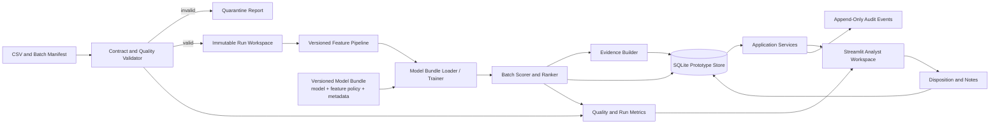

# Complete Solution, 14-Hour AI-Assisted Execution Plan

**Purpose:** Build a credible end-to-end prototype in 13–14 hours while preserving the complete solution design in [`01_system_architecture.md`](01_system_architecture.md). The delayed-transaction extension and its measurable acceptance protocol are defined in [`03_delayed_transaction_resilience.md`](03_delayed_transaction_resilience.md).

**Architecture principle:** The timebox changes implementation depth, packaging, and sequencing. It does not remove required capabilities. Every important concern is either implemented as a working vertical slice, represented by an enforced contract, or recorded with a clear production-hardening path.

**Safety boundary:** The system ranks accounts for authorized human review. It does not freeze accounts, file reports, or claim production readiness from the current confounded dataset.

## 1. What “Complete” Means for This Prototype

A complete prototype must demonstrate the whole decision path:

1. ingest a feature batch and its metadata;
2. validate schema, identity, provenance, exclusions, and data quality;
3. transform data using a versioned feature policy;
4. load or train a reproducible model bundle;
5. score and rank accounts;
6. produce evidence-limited explanations;
7. present a usable analyst review workflow;
8. capture dispositions and audit events;
9. expose run health, quality checks, and drift indicators;
10. preserve the seams needed for secure deployment and later production hardening.

The prototype is **capability-complete** when all ten steps are visible and connected. It is not production-hardened until representative temporal data, approved feature definitions, stable account identity, security integration, load testing, and independent validation exist.

## 2. Architecture for the 14-Hour Build

Use a modular monolith with a Streamlit interface and a Python application/service layer. Persist prototype state in SQLite and versioned local artifacts. Keep storage, model registry, and API boundaries behind interfaces so PostgreSQL, MLflow, and FastAPI can be added without rewriting the domain logic.



This topology is one deployable process for speed, but the internal boundaries mirror the target architecture:

- Streamlit is an adapter over application services, not the home of business logic.
- SQLite implements a repository interface that can later use PostgreSQL.
- A filesystem model catalog implements a model-registry interface that can later use MLflow.
- Local metric records implement the same run/quality vocabulary later exported to Prometheus.
- A service layer can later be exposed through FastAPI without changing scoring or governance rules.

## 3. Capability Coverage and Hardening Path

| Capability | Working implementation in 14 hours | Contract/scaffold preserved now | Production hardening after prototype |
|---|---|---|---|
| Batch ingestion | CSV upload/path selection, checksum, generated `batch_id`, immutable run directory | Manifest schema and ingestion result types | Object storage, upstream connector, retry orchestration |
| Data contract | Column checks, target separation, exclusion-policy check, row count, duplicate and missingness summary | Required `account_id`, `snapshot_at`, source and label-maturity fields | Approved source contract and producer-side enforcement |
| Quarantine | Failed validation report with stable error codes; scoring blocked | Quarantine repository interface | Operations queue, alert routing, retention policy |
| Feature pipeline | Reuse Stage 9 exclusions and fold-safe transformations | Versioned feature-policy manifest and expected input signature | Certified feature dictionary and point-in-time feature computation |
| Model lifecycle | Load a pinned LightGBM bundle; reproducible retraining command if needed | Model metadata, data hash, dependency versions, metrics and status | Shared MLflow registry, approval workflow, signatures |
| Scoring | Idempotent batch scoring, percentile rank and top-K queue | Scoring-run state machine and repository interface | Scheduled workers, concurrency controls, retry/resume |
| Explainability | Top signed model contributions with raw value/percentile and “meaning unverified” label | Structured evidence schema | Approved business names, reason-code governance, reviewer validation |
| Analyst workflow | Queue, filters, case detail, evidence, notes and disposition | Role and action vocabulary; application service boundary | SSO, granular RBAC, assignment queues, four-eyes controls |
| Auditability | Append-only event table/file for run and analyst actions | Actor, action, entity, timestamp, before/after metadata | Tamper-evident centralized audit storage and retention controls |
| Monitoring | Data-quality card, run status, durations, score distribution and missingness drift | Metric names and thresholds in configuration | Prometheus/Grafana, alert routing, delayed-label performance |
| Delayed transaction resilience | Synthetic event fixture, durable local buffer, freshness state, and impacted-account reconciliation | Event/sequence contract and score-version state machine | Managed event log, partition watermarks, operational alerts, replay benchmark |
| Security | Local-only bind by default, no secrets in code, input limits, redacted logs | Authorization interface and deployment checklist | TLS, SSO, secrets manager, encryption policy, security testing |
| Deployment | One command or Docker container with pinned dependencies | Environment configuration and health check | Managed database, backup/restore, HA and formal RPO/RTO |
| Testing | Focused contract, leakage-boundary and end-to-end smoke tests | Stable fixtures and acceptance command | Load, recovery, security and independent model validation |

No capability disappears because its enterprise implementation cannot fit inside the timebox. The prototype supplies either real behavior or an enforceable seam with explicit acceptance criteria.

## 4. Scope Priorities

### P0 — Required for a credible end-to-end prototype

- deterministic environment and configuration;
- input validation with hard stop on incompatible data;
- registered 1,404-column exclusion policy and feature-count verification;
- model bundle containing model, transformations, feature list, metadata, and checksums;
- batch scoring and ranked analyst queue;
- evidence-limited case detail with no invented feature meanings;
- analyst notes/disposition plus audit event;
- run and data-quality summary;
- a ten-minute delayed-event fixture demonstrating buffering, freshness status, and targeted reconciliation mechanics;
- end-to-end smoke test and repeatable start command;
- visible statement that current metrics are development diagnostics because target and extraction month are confounded.

### P1 — Complete if P0 is stable

- queue filters, configurable top-K, CSV export, and case assignment status;
- model-comparison view using saved Stage 9 metrics;
- missingness/score-distribution comparison against the development reference;
- Dockerfile and health endpoint or health command;
- lightweight FastAPI adapter over the same application services.

### P2 — Preserve the design; implement only with remaining time

- local MLflow UI;
- Prometheus endpoint and Grafana dashboard;
- PostgreSQL Compose profile;
- authentication provider integration;
- scheduled execution.

P2 services do not determine whether the fraud-ranking approach is complete. Their interfaces and data contracts do. They become mandatory before a shared or production-like deployment.

## 5. Fourteen-Hour Build Sequence

The schedule reserves integration and verification time because generated modules are useful only when the complete path works.

| Time | Work package | Concrete exit condition |
|---:|---|---|
| 0:00–0:45 | Freeze acceptance criteria, configuration, module boundaries, and demo input | One documented command and one agreed end-to-end scenario |
| 0:45–1:45 | Batch contract, checksum, validation, exclusion-policy verification, quarantine output | Invalid input cannot reach scoring; valid input creates a versioned run |
| 1:45–2:45 | Delayed-event fixture, durable buffer, freshness state and reconciliation service | A ten-minute late event is retained, applied once, and linked to a corrected version |
| 2:45–4:00 | Package fold-safe preprocessing and create/load the model bundle | Bundle verifies feature signature and reproduces a known score path |
| 4:00–5:00 | Scoring, rank/percentile calculation, top-K selection, evidence schema | Saved result has run, data, policy, and model identifiers |
| 5:00–7:15 | Streamlit queue, case view, freshness status, explanations, provenance and limitations | Analyst can move from batch to ranked case evidence without blocking on reconciliation |
| 7:15–8:15 | Disposition, notes, repository and append-only audit events | Review action persists and appears in case history |
| 8:15–9:15 | Quality/drift/run-health views and configurable thresholds | Schema, missingness, cohort and score changes are visible |
| 9:15–10:30 | Contract tests, leakage-boundary checks and end-to-end smoke test | Clean run passes; incompatible bundle and invalid input fail safely |
| 10:30–11:30 | Dependency pinning, start scripts, Dockerfile/health command | Prototype starts from documented clean setup |
| 11:30–12:30 | Full demo rehearsal using a bounded sample; repair integration faults | Ingest-to-disposition flow completes without manual data edits |
| 12:30–13:15 | README, architecture traceability, model/data limitation text | Reviewer can trace every screen value to an artifact or event |
| 13:15–14:00 | Contingency buffer and final verification | Acceptance checklist and known limitations are recorded |

If time is lost, remove optional visual polish and auxiliary service adapters first. Preserve validation, ranking, explanations, auditability, and verification because they constitute the actual solution.

## 6. Proposed Implementation Structure

```text
.
├── app.py                          # Thin Streamlit entry point
├── config/
│   ├── prototype.yaml
│   ├── feature_policy.yaml
│   └── monitoring.yaml
├── contracts/
│   ├── batch_manifest.schema.json
│   └── model_bundle.schema.json
├── src/mule_detection/
│   ├── application/
│   │   ├── ingest_service.py
│   │   ├── scoring_service.py
│   │   └── review_service.py
│   ├── domain/
│   │   ├── contracts.py
│   │   ├── policies.py
│   │   └── events.py
│   ├── ingestion/
│   │   ├── loader.py
│   │   ├── validator.py
│   │   ├── event_buffer.py
│   │   └── reconciliation.py
│   ├── features/pipeline.py
│   ├── modeling/bundle.py
│   ├── scoring/ranker.py
│   ├── explanations/evidence.py
│   ├── monitoring/quality.py
│   ├── persistence/
│   │   ├── repositories.py
│   │   └── sqlite.py
│   └── ui/
│       ├── queue_page.py
│       ├── case_page.py
│       └── operations_page.py
├── models/active/                  # Versioned local bundle
├── runs/                           # Generated immutable run workspaces
├── tests/
│   ├── test_contracts.py
│   ├── test_feature_boundaries.py
│   ├── test_delayed_event_reconciliation.py
│   └── test_end_to_end.py
├── scripts/
│   ├── pre_architecture_verification.py
│   ├── build_model_bundle.py
│   └── run_smoke_test.py
├── Dockerfile
└── requirements.txt or pyproject.toml
```

Codex can generate these modules quickly, but each module must be joined through typed contracts and exercised through the end-to-end test. Parallel code generation without integration evidence does not satisfy the definition of done.

## 7. Data and Model Decisions That Stay Mandatory

1. **The current dataset remains research-only.** Positives and negatives occupy different extraction months, so the prototype must display cohort limitations and cannot claim future-period performance.
2. **The existing 1,817-row split remains unscored.** It is an internal reference artifact, not a production acceptance cohort.
3. **Preprocessing remains fit-boundary safe.** Any learned imputation, pruning, encoding, or selection is fitted only on the training portion of a fold or on the approved training dataset used to build a frozen bundle.
4. **Ranking is the output.** Display percentile and queue rank; avoid presenting the raw score as a calibrated probability until calibration is validated at representative prevalence.
5. **Explanations stay evidence-limited.** Anonymous fields use feature ID, observed value, peer percentile, direction/contribution, and dictionary status.
6. **Human review is authoritative.** Demographics and model scores cannot independently trigger adverse action.
7. **Every output is traceable.** Each score includes `run_id`, input hash, feature-policy version, model version, and timestamp.

## 8. Definition of Done at Hour 14

The prototype is ready to demonstrate only when all of these are true:

- a user can supply a valid batch and receive a ranked review queue;
- invalid schema, missing exclusions, duplicate identity, or model-feature mismatch blocks scoring with a useful report;
- a selected case shows traceable evidence without unsupported business interpretation;
- a reviewer can save a disposition and see its audit history;
- the operations view shows batch status, row counts, validation findings, duration, score distribution, and drift indicators;
- the delayed-event fixture preserves the last complete score, reconciles the affected account, and leaves ordinary dashboard reads available;
- rerunning the same input is idempotent or creates an explicitly versioned replay;
- the model bundle and result rows identify their data, code/config, dependency, and feature-policy versions;
- the saved holdout is untouched by prototype model selection and demonstration metrics;
- the end-to-end smoke test passes from a clean command;
- the README states the known data limitations and the gates required before production use.

## 9. Immediate Post-Prototype Gates

The next work is driven by risk, not by adding more interface features:

1. Obtain a stable pseudonymous account identifier and approved source/feature dictionary.
2. Obtain representative time windows containing both mature positive and negative outcomes.
3. Run grouped temporal validation and uncertainty analysis on the new cohort.
4. Review sensitive/demographic attributes, reason codes, and analyst policy with compliance.
5. Move repositories to PostgreSQL, model metadata to MLflow, metrics to Prometheus/Grafana, and identity to organizational SSO.
6. Perform security, load, backup/restore, and failure-recovery tests before a controlled shadow pilot.

This keeps the prototype honest: it demonstrates the complete operating concept now and leaves clearly defined evidence and infrastructure gates for deployment.
