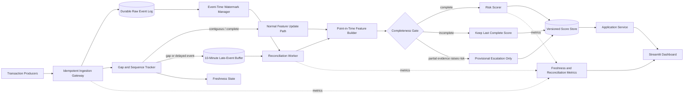

# Delayed and Missing Transaction Resilience

**Status:** Required architecture extension; empirical acceptance is blocked until timestamped transaction-level data or a representative event fixture exists.

**Related documents:** [`01_system_architecture.md`](01_system_architecture.md), [`02_complete_solution_14h_execution_plan.md`](02_complete_solution_14h_execution_plan.md), and [`../eda/09_pre_architecture_verification_and_remediation.md`](../eda/09_pre_architecture_verification_and_remediation.md).

## 1. Counter to the Assumption

The current repository does **not** ingest a live transaction stream. Its dataset contains one high-dimensional account-level snapshot and lacks verified transaction event IDs, event timestamps, source sequence numbers, and counterparties. The current batch scorer therefore does not depend on ten-minute transaction freshness, and the Streamlit design must not present its output as a complete real-time risk landscape.

The production concern is still valid. Once transaction-derived features are supplied continuously, delayed or missing records can make a newly calculated feature window incomplete. The safe response is not to silently score missing values as normal activity. The system must track completeness independently from model risk, preserve the last complete assessment, and reconcile only affected accounts when delayed records arrive.

This extension adds that behavior without interrupting ordinary batch scoring or dashboard reads.

## 2. Required Outcome

For transaction records delayed by up to ten minutes:

- unaffected accounts continue through the normal scoring path;
- affected records are durably buffered and deduplicated;
- the dashboard continues serving the last complete version of each affected account’s assessment;
- a partial assessment may raise review priority but cannot lower a prior complete priority;
- affected accounts are recomputed from event time after the missing records arrive;
- corrected assessments are atomically published with lineage and an audit event;
- the validation run must preserve the reference assessment for at least 95% of eligible accounts;
- p95 compute time for affected-account reconciliation must increase by no more than 5% relative to timely processing.

The deliberate ten-minute source delay is measured as **data freshness lag**, not processor execution time. Otherwise the injected upstream delay would, by definition, violate the processing-time requirement before the system receives the record. Both measurements must be reported separately.

## 3. Revised Architecture



### Why normal operations remain unaffected

The gap tracker sends contiguous, on-time data directly to the normal feature path. Only accounts connected to a detected source gap enter reconciliation. The dashboard reads versioned scores from the score store rather than waiting for ingestion or model execution. Publishing uses an atomic version change, so users see either the previous complete assessment or the reconciled assessment, never a partially written mixture.

## 4. Transaction and Source Contract

Reliable missing-record detection requires source evidence. A period with no transactions is indistinguishable from a broken feed unless the producer supplies sequence or completeness information.

Each transaction event must contain:

| Field | Purpose |
|---|---|
| `event_id` | Global or source-scoped idempotency key |
| `account_id` | Stable pseudonymous account identity |
| `event_time` | Time the transaction occurred |
| `ingested_at` | Time the platform received it |
| `source_id` and `source_partition` | Source lineage and independent watermark tracking |
| `source_sequence` | Detect gaps and out-of-order delivery |
| `event_type`, `amount`, `currency`, `direction` | Minimum feature payload; exact fields require an approved dictionary |
| `schema_version` | Safe event evolution |
| `correction_of` or `reversal_of` | Correct previously published source records |

The producer must also emit a heartbeat or batch manifest containing the latest committed sequence and expected record count. The consumer acknowledges a source position only after the raw event is durably written.

## 5. Buffering and Reconciliation Policy

### Ingestion

1. Validate the event contract.
2. Deduplicate on `(source_id, event_id)`.
3. Append the unchanged event to durable storage before acknowledging it.
4. Update the per-partition sequence tracker.
5. Route contiguous records to normal feature aggregation.
6. When a sequence gap, late timestamp, heartbeat failure, or count mismatch appears, mark only the impacted accounts/windows as incomplete.

### Watermark and grace interval

- Maintain a watermark independently for each source partition.
- Use a ten-minute allowed-lateness interval for the stated requirement.
- Close a feature window only after its source watermark passes the window boundary and required sequences are present.
- Run reconciliation at least once per minute, giving a target maximum of eleven minutes from original event time to reconciled publication for a record delayed by the full ten minutes.
- Make the allowed-lateness interval configurable from measured source-delay distributions rather than hard-coding it in model logic.

### Assessment states

| State | Meaning | Dashboard behavior | Decision behavior |
|---|---|---|---|
| `COMPLETE` | All required sources reached the assessment watermark | Show current score and “complete as of” time | Normal analyst workflow |
| `BUFFERING` | Gap detected and still inside ten-minute grace interval | Keep last complete score; show freshness warning | No downgrade or closure based on partial data |
| `PROVISIONAL_HIGHER` | Available partial evidence raises risk | Show raised priority and incomplete badge | Analyst may review; no automated adverse action |
| `RECONCILED` | Late events applied and assessment republished | Show new version and reconciliation timestamp | Normal analyst workflow with prior version retained |
| `STALE` | Gap exceeded the grace interval | Prominent stale indicator and source reason | Escalate operationally; retain last complete score |
| `CORRECTED` | Event arrived after closure or was reversed | Show corrected version and audit history | Reopen review when policy threshold is crossed |

The model risk score and data-quality/freshness status remain separate fields. A low score never hides incomplete source data.

### Reconciliation

1. Read buffered events and the last complete feature snapshot for the impacted account/window.
2. Rebuild order-sensitive features by `event_time`; update associative aggregates incrementally where safe.
3. Verify that source sequences and expected counts are now complete.
4. Score each affected account once using the frozen model bundle.
5. Compare the new score, rank band, and explanation with the prior version.
6. Commit the feature snapshot, score, freshness state, and audit event in one transaction.
7. Publish the new version atomically and retain the previous version for traceability.

Late events never mutate historical evidence in place.

## 6. Prototype and Production Implementations

| Concern | 13–14 hour prototype | Production implementation |
|---|---|---|
| Durable event log | SQLite write-ahead-log table or append-only local file | Kafka-compatible log or the bank’s managed event platform |
| Late-event buffer | SQLite table keyed by account/window/event | Partitioned durable stream/state store |
| Gap detection | Synthetic fixture sequences plus manifest/heartbeat checks | Producer offsets, sequence monitoring, source SLAs |
| Reconciliation | One-minute worker command over impacted accounts | Partitioned workers with retry and dead-letter handling |
| Feature state | Versioned local snapshots | Point-in-time feature storage with transactional metadata |
| Score publication | SQLite transaction and version pointer | Transactional database/outbox pattern |
| Dashboard | Freshness badge, last complete score, reconciliation history | Same behavior through authenticated application API |
| Monitoring | Local metrics table and operations page | Prometheus/Grafana and operational alerts |

This extension adds an adapter and services around the existing scorer. It does not require changing the trained model for the buffering mechanism itself. Model retraining becomes necessary only if new transaction-derived features are added to its input signature.

## 7. Demonstration and Acceptance Test

### Evidence limitation

The current 9,082-row dataset cannot empirically demonstrate a ten-minute transaction delay. It has no transaction-level event times, sequence IDs, or known timely version against which to compare a delayed version. Any claim that this repository has already achieved 95% accuracy preservation and 5% processing overhead would be fabricated.

The redesign is accepted through a replay test using a timestamped transaction fixture or production-like historical ledger.

### Reference and delayed runs

1. Select a frozen event interval and a frozen model bundle.
2. **Reference run:** replay every event in event-time order with zero artificial delay.
3. **Delayed run:** delay a stratified sample of records by exactly ten minutes. Include high-value events, high-risk accounts, source partitions, and window-boundary events rather than sampling only easy cases.
4. Keep event contents, model, configuration, and hardware/container allocation identical.
5. Reconcile after the delayed events arrive and compare account-level results.

### Required metrics

Let `E` be accounts eligible in both runs and `A` be the accounts affected by an injected delay.

```text
assessment_consistency =
  count(account in E where
        final_risk_band_delayed == risk_band_reference
        and abs(final_score_delayed - score_reference) <= epsilon)
  / count(E)

affected_processing_overhead =
  (p95_compute_ms_delayed(A) - p95_compute_ms_reference(A))
  / p95_compute_ms_reference(A)

freshness_lag = reconciled_published_at - event_time
```

Acceptance gates:

| Gate | Required result |
|---|---:|
| Final assessment consistency | `>= 95%` of eligible accounts |
| Top-K queue overlap | `>= 95%` for the operational review budget |
| Affected-account processing overhead | `<= 5%` at p95, excluding intentional source delay and queue waiting |
| Unaffected-account processing regression | `<= 5%` at p95 |
| Duplicate or lost events | `0` |
| Partial-data downgrades | `0` |
| Reconciliation traceability | `100%` of corrected scores linked to events/model/features |
| Ten-minute-delay freshness | p95 publication within 11 minutes of event time, subject to the one-minute reconciliation cadence |

Also report AP, ROC-AUC, precision/recall at the review budget, score deltas, and rank displacement when mature labels exist. Assessment consistency tests system correctness; it does not replace predictive validation.

### Why the design should preserve the reference result

After reconciliation, the complete event set, event-time ordering, feature policy, and frozen model are the same in both runs. Deterministic feature recomputation should therefore produce the same feature vector and score. The 95% gate allows explicitly documented nondeterminism or boundary effects, but unexplained mismatches are defects. This is a testable invariant, not a substitute for running the replay benchmark.

The 5% processing gate is achieved operationally by keeping normal accounts on the fast path, indexing the buffer by account/window, updating safe aggregates incrementally, recomputing only impacted accounts, batching model inference, and scoring each corrected account once. It must be measured on target hardware and representative volume before acceptance.

## 8. Monitoring and Failure Response

Track at minimum:

- event arrival lag p50/p95/p99 by source partition;
- watermark age and heartbeat age;
- open sequence gaps and oldest gap age;
- buffered event and impacted-account counts;
- reconciliation duration, retries, and failures;
- percentage of scores in each freshness state;
- score/rank changes after reconciliation;
- duplicate, correction, and dead-letter counts;
- normal-path and reconciliation-path processing latency separately.

Alert when the watermark age exceeds ten minutes, a partition heartbeat is absent, buffer depth grows continuously, reconciliation failures repeat, or stale assessments exceed the agreed operational threshold.

## 9. Risks and Controls

| Risk | Control |
|---|---|
| Source silently drops records | Producer sequence plus heartbeat/count manifest; watermark alone is insufficient |
| Duplicate delivery | Idempotency key and unique constraint |
| Out-of-order records corrupt windows | Event-time rebuild for order-sensitive features |
| Partial data lowers risk | Last complete score remains authoritative; provisional path can only escalate |
| Dashboard shows mixed versions | Atomic score-version publication |
| Late correction changes an investigated case | Immutable history, audit event, policy-based case reopening |
| Buffer outage loses records | Durable write before acknowledgement and recovery replay |
| Ten-minute buffer grows under source failure | Backpressure, capacity alert, stale state, and dead-letter process |
| Reconciliation slows normal scoring | Separate work queue/resource limit and impacted-account-only recomputation |
| “Accuracy” is confused with consistency | Report system consistency and predictive metrics separately |

## 10. Architecture Decision

Adopt the dual-path design:

- on-time, contiguous data follows the existing fast path;
- incomplete accounts retain a versioned last complete assessment;
- delayed records enter a durable ten-minute buffer;
- targeted reconciliation republishes only affected accounts;
- the dashboard exposes freshness and completeness as first-class evidence.

The architecture satisfies the operational requirement by design. The numerical 95% and 5% claims remain acceptance gates until they are measured with timestamped transaction data on representative hardware.
