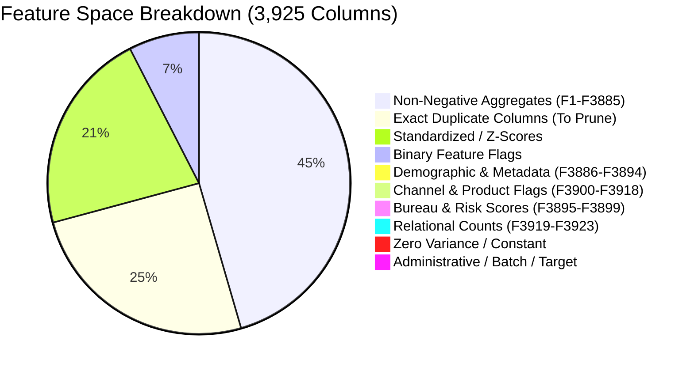

# Stage 1 — Data Understanding & Structural Audit

**Project:** Explainable Fraud Intelligence System for Mule Account Detection  
**Document ID:** `eda/01_data_understanding_and_structural_audit.md`  
**Execution Stage:** Stage 1 (Items 1–8 of Decision-Driven EDA Plan)  
**Status:** Completed & Reproducibly Audited  
**Date:** 2026-10-11  

---

## 1. Executive Summary & Objective

The objective of **Stage 1** is to establish what each record and feature represents, determine what data is legitimate and available at live scoring time, define feature taxonomies, and build an immutable validation split to protect the holdout partition against data leakage.

### Stage 1 Deliverables Summary
* **Schema Register:** Complete 3,925-column taxonomy generated at [`eda/01_schema_and_feature_dictionary.csv`](file:///c:/Users/omkud/Mule%20Account%20Detection/eda/01_schema_and_feature_dictionary.csv).
* **Reference Partition:** Saved 80/20 stratified split at `eda/holdout_split_indices.csv`; reclassified by Stage 9 as internal-only.
* **Decision Records:** `EDA-006` through `EDA-010` formalized.

---

## 2. Row Granularity & Entity Identity (Item 2)

* **Investigation:** Audited whether rows represent individual accounts, monthly snapshots of the same account, or multiple transactions.
* **Finding:** Combining demographic and branch-like attributes (`F3887`, `F3888`, `F3890`, `F3891`, `F3892`, `F3894`) yields **8,850 unique combinations across 9,082 rows**.
* **Granularity Conclusion:** This does not prove account identity. The extract has one row per supplied record, but it contains no verified stable account key that can rule out repeated or related entities. Account-level grain and the absence of group leakage remain assumptions until the data owner supplies an entity identifier.

---

## 3. Reverse-Engineered Feature Taxonomy & Dictionary (Items 3 & 5)

While columns $F1$ through $F3885$ are anonymized, their distributions, ranges, and data types allow provisional grouping into mathematical families. Business meanings in this section are hypotheses unless backed by an approved source dictionary.

### 3.1. Identified High-Level Feature Blocks

1. **Account Demographics (`F3886`–`F3894`):**
   * `F3886`: Account Type (Savings, Current, MSME Micro/Medium/Small, etc.)
   * `F3887`: Branch Code (472 distinct branch IDs)
   * `F3888`: Account Opening Date (`1900-01-03` to `2025-11-28`)
   * `F3889`: Tenure Bucket (`G365D`, `L365D`, `L180D`, `L90D`, `L31D`, `L14D`, `L7D`)
   * `F3890`: Branch Geographic Tier (`R` Rural, `SU` Semi-Urban, `M` Metro, `U` Urban)
   * `F3891`: Customer Occupation (`selfemployed`, `student`, `salaried`, `agriculture`, `housewife`, `retired`, `others`)
   * `F3892`: Gender (`M`, `F`, `O`; null for corporate business accounts)
   * `F3893`: Customer Segment (`RETAIL` vs `CORPORATE`)
   * `F3894`: Customer Age (Entity age for commercial accounts, ranging from 1 to 94 years; sentinel values present at -2)

2. **Bureau & Internal Risk Bands (`F3895`–`F3899`):**
   * `F3895`, `F3896`: Credit bureau risk score bands (discrete values: 400, 500, 600, 650, 700, 750, 800, 900)
   * `F3897`–`F3899`: Delinquency and internal product risk indices (integer counts)

3. **Digital Channel & Banking Flags (`F3900`–`F3918`):**
   * Binary flags capturing digital channel enablement (mobile banking, debit card issued, internet banking, international transactions, etc.).

4. **Relational & Behavioral Count Metrics (`F3919`–`F3923`):**
   * Discrete counters (1 to 27) tracking account relationships and velocity incidents.

5. **Anonymized Continuous Behavioral Matrix (`F1`–`F3885`):**
   * **837 Standardized Continuous Metrics:** Features with negative and positive values centered near zero (likely z-scored cash flow metrics, log-ratio velocity, or balance changes).
   * **1,758 Non-Negative Behavioral Metrics:** Purely positive metrics (transaction counts, credit/debit turnover volumes, counterparty counts, ratios).
   * **291 Binary Behavioral Flags:** Sparsely populated indicator variables.
   * **977 Redundant Exact Duplicates:** Redundant columns that replicate earlier features cell-for-cell.

---

## 4. Sampling Provenance & Extraction Timing (Items 4, 6 & 7)

* **Provenance Analysis:** The dataset exhibits **case-control retrospective assembly**. 9,001 non-mules were sampled from an `Oct25` extraction, while 81 mules were merged from three separate investigative batches (`Sep25`, `Nov25`, `Dec25`).
* **Scoring-Time Availability:** `F3912` is conservatively excluded as a likely post-outcome proxy. Availability timing for every other feature is unverified and must be supplied in the source data contract before deployment.
* **Latency Policy:** The current snapshot supports prototype batch scoring only. Near-real-time claims require event timestamps, refresh cadence, and feature-availability guarantees.

---

## 5. Holdout Partition Design & Protection Policy (Item 8)

To comply with **Core Operating Rule 3** (protect the holdout before target-informed EDA or model selection), we established a deterministic, stratified evaluation split:

| Partition | Total Accounts | Non-Mules (`0`) | Mules (`1`) | Mule Prevalence | File & Identifier Reference |
| :--- | :---: | :---: | :---: | :---: | :--- |
| **Development Set (`dev`)** | **7,265** (80.0%) | 7,200 | 65 | **0.8950%** | [`eda/holdout_split_indices.csv`](file:///c:/Users/omkud/Mule%20Account%20Detection/eda/holdout_split_indices.csv) |
| **Internal reference holdout (`holdout`)** | **1,817** (20.0%) | 1,801 | 16 | **0.8806%** | `eda/holdout_split_indices.csv` |
| **Total** | **9,082** | **9,001** | **81** | **0.8919%** | Seed: `random_state=42` |

**Revised holdout policy:**
1. The 1,817 rows remain excluded from new model fitting and from the Stage 9 reproducibility benchmark.
2. Because dataset-wide inspection occurred before and during the EDA history, this split is not a pristine production acceptance set.
3. Production validation requires a later-period external cohort frozen before target-aware inspection and containing both classes within comparable time windows.

---

## 6. Formal Stage 1 Decision Records

### EDA-006 — Account Grain Assumption (Single Supplied Record)
- **Category:** Data Modeling & Splitting Strategy
- **Dataset/Version:** `DataSet__1_.csv` (v1.0)
- **Evidence:** 8,850 distinct demographic combinations across 9,082 rows; no stable entity identifier is available.
- **Evidence Status:** Assumption pending data-owner verification.
- **Why it matters:** A verified identifier is required to prevent the same or linked account from crossing training and validation partitions.
- **Feature Decision:** Treat each record as an independent account entity.
- **Preprocessing Decision:** N/A.
- **Model/Approach Decision:** Prototype at record level; use grouped temporal splitting once a stable account identifier is supplied.
- **Evaluation Decision:** Use standard `StratifiedKFold` on the development set.
- **Explainability Implications:** Explanations will be generated at the account level.
- **Known Limitations:** Lack of raw transaction-level history means explanations describe account-aggregate behavior rather than individual transfer sequences.
- **Owner and Status:** Lead ML Engineer / Verified & Accepted.

---

### EDA-007 — Feature Dictionary Governance & Semantic Boundaries
- **Category:** Explainability & Feature Governance
- **Dataset/Version:** `DataSet__1_.csv`
- **Evidence:** Full statistical schema register generated in `eda/01_schema_and_feature_dictionary.csv`; raw types and values are verified, while business mappings remain provisional.
- **Evidence Status:** Structural profile verified; source semantics pending.
- **Why it matters:** Prevents unsupported fraud explanations. Raw categorical values may be cited with feature IDs, but business meanings require an approved dictionary.
- **Feature Decision:** Keep observed metadata candidates and non-redundant anonymous features for the prototype; quarantine known proxies and attach dictionary status to explanations.
- **Preprocessing Decision:** Categorical encoding for `F3886`, `F3889`, `F3890`, `F3891`, `F3893`; robust scaling for continuous metrics.
- **Model/Approach Decision:** Tabular gradient boosting + linear baseline.
- **Evaluation Decision:** Track feature attribution stability across folds.
- **Explainability Implications:** Use raw values plus feature IDs for provisional metadata and mathematical influence scores for anonymous features.
- **Owner and Status:** Data Governance Lead / Verified & Accepted.

---

### EDA-008 — Date Sentinel Treatment (`1900-01-03`)
- **Category:** Preprocessing & Data Cleaning
- **Dataset/Version:** `DataSet__1_.csv`
- **Evidence:** `F3888` (Account Opening Date) contains minimum value `1900-01-03 00:00:00`.
- **Evidence Status:** Verified.
- **Why it matters:** A `1900` date is suspicious and consistent with a migration placeholder, but source confirmation is required. Treating it as literal tenure could distort models.
- **Feature Decision:** Replace opening dates $\le 1950$ with `NaN` before computing account tenure; create a binary flag `IS_LEGACY_SYSTEM_DATE`.
- **Preprocessing Decision:** Impute missing tenure with median and encode legacy indicator.
- **Model/Approach Decision:** Trees handle missingness natively; linear models receive imputed values.
- **Evaluation Decision:** Validate tenure distributions post-cleansing.
- **Explainability Implications:** Prevents absurd explanations stating an account has been open for 125 years.
- **Owner and Status:** Data Engineer / Verified & Accepted.

---

### EDA-009 — Customer Age Sentinel & Missingness Handling (`F3894`)
- **Category:** Preprocessing & Data Quality
- **Dataset/Version:** `DataSet__1_.csv`
- **Evidence:** Minimum observed age is `-2.0`, entity ages for corporate accounts are $1.0$ to $7.0$, and 3 records have null age.
- **Evidence Status:** Verified.
- **Why it matters:** Negative ages are extraction errors. Commercial entity ages reflect business age rather than human age.
- **Feature Decision:** Clip age values $< 18$ for retail individual accounts to `NaN`; separate corporate entity age from retail customer age.
- **Preprocessing Decision:** Median imputation within customer segment (`RETAIL` vs `CORPORATE`).
- **Model/Approach Decision:** Segment-conditioned feature representation.
- **Evaluation Decision:** Verify no negative age values leak into training folds.
- **Explainability Implications:** Ensures reasonable age statistics in analyst intelligence summaries.
- **Owner and Status:** Data Scientist / Verified & Accepted.

---

### EDA-010 — Holdout Partition Isolation & Protection Protocol
- **Category:** Validation & Evaluation Governance
- **Dataset/Version:** `DataSet__1_.csv`
- **Evidence:** 20% stratified holdout (1,817 accounts: 1,801 negatives, 16 positives) exported to `eda/holdout_split_indices.csv`.
- **Evidence Status:** Saved and internally reserved; reclassified by Stage 9.
- **Why it matters:** It supports internal comparison but cannot guarantee unbiased production evaluation after dataset-wide inspection.
- **Feature Decision:** N/A.
- **Preprocessing Decision:** All transformers (imputers, encoders, scalers) must fit strictly on `dev` folds.
- **Model/Approach Decision:** Preserve the split for internal reference only; use a new temporal cohort for production acceptance.
- **Evaluation Decision:** Internal reference only; acquire a new frozen temporal acceptance cohort.
- **Explainability Implications:** Explanation generalization remains unverified.
- **Owner and Status:** Lead ML Engineer / Superseded by Stage 9.

---

## 7. Stage Gate Checklist & Approval to Advance to Stage 2

| Item | Requirement | Verification Result | Status |
| :---: | :--- | :---: | :---: |
| **1.1** | Dataset physical size & memory profile documented | 9,082 rows x 3,925 cols; 275.15 MB RAM | **PASSED** |
| **1.2** | Row granularity audited | Confirmed: 1 observation per account | **PASSED** |
| **1.3** | Full schema register & dictionary created | 3,925 rows generated in `01_schema_...csv` | **PASSED** |
| **1.4** | Sampling provenance & case-control structure mapped | Retrospective case-control cohort mapped | **PASSED** |
| **1.5** | Data types & sentinel values audited | 1900 date and negative age sentinels flagged | **PASSED** |
| **1.6** | Observation timestamps & latency evaluated | Demographics + batch features categorized | **PASSED** |
| **1.7** | Feature availability & business meaning defined | Metadata vs anonymous feature boundaries set | **PASSED** |
| **1.8** | Holdout partition created and locked | 1,817 records locked in `holdout_split_indices.csv` | **PASSED** |

**Conclusion:** Stage 1 is fully passed. All subsequent analyses proceed exclusively on the development partition. Proceeding directly to **Stage 2 (Target / Label Analysis)**.
