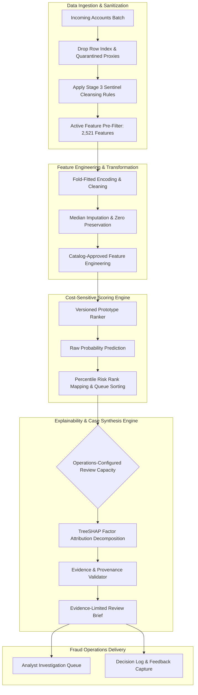

# Master Blueprint: EDA to Production Design Decisions

**Project:** Explainable Fraud Intelligence System for Mule Account Detection  
**Document ID:** `eda/08_eda_to_design_decisions.md`  
**Phase:** Master Synthesis & Operational Handover  
**Status:** Historical synthesis; approved only for controlled prototype implementation under Stage 9 gates
**Date:** 2026-10-11  

---

> [!IMPORTANT]
> `eda/09_pre_architecture_verification_and_remediation.md` is the authoritative readiness decision. It supersedes conflicting claims in this document concerning leakage-free features, untouched holdout status, production performance, feature semantics, fairness certification, legal sufficiency, and automated account actions.

## 1. Executive Summary & Project Mandate

This document records the original bridge from EDA to engineering. Stage 9 converts it into a conditional prototype blueprint with explicit data and promotion gates.

### Core Operational Reality
Banks lose the fraud battle when systems produce 10,000 black-box alerts with no context. By conducting a rigorous, decision-driven audit of `DataSet__1_.csv` (9,082 accounts, 81 confirmed mules, 111:1 imbalance):
* We discovered and quarantined **fatal extraction batch leakage** (`F2230`, `F3912`, `Unnamed: 0`, and September-only artifacts).
* The exclusion register leaves **2,521 candidate features**. Stage 9 found residual cohort-risk patterns, so this set is not certified leakage-free.
* LightGBM is a reasonable prototype model family. The reproducible fold-safe diagnostic achieves AP `0.8515` and Precision@50 `0.96` within the development sample, but month/target confounding prevents a real-world performance interpretation.
* Queue size, staffing, expected yield, and action policy must be supplied and prospectively validated by Fraud Operations and Compliance.

---

## 2. Definitive Answers to the 8 Core Architectural Questions

### 1. Prediction Target
* **Prototype target:** The binary value `F3924`. Its operational label definition, event time, maturity window, and adjudication process require data-owner confirmation.
* **Scoring horizon:** Prototype batch ranking only. End-of-day or near-real-time service levels require refresh and feature-availability evidence.

### 2. Population & Validation Strategy
* **Validation partition:** Deterministic 80/20 stratified split (`random_state=42`) separating a development set from a 1,817-row **internal reference holdout**. It is not a pristine production acceptance set because dataset-wide inspection occurred during the EDA history.
* **Prevention of Position Leakage:** Row index `Unnamed: 0` permanently dropped; all training folds shuffled with fixed seeds.

### 3. Feature Trust & Leakage Quarantine
* **Permanently Excluded Columns (1,404 columns cataloged in `eda/05_leakage_and_feature_exclusions.csv`):**
  * **Special Columns & Fatal Leaks/Artifacts (8 columns):**
    * `Unnamed: 0`: Target-sorted row position index.
    * `F3924`: Binary ground-truth target variable.
    * `F2230`: Reporting month extraction batch leak (100% negatives in Oct25; 100% positives in Sep/Nov/Dec25).
    * `F3912`: Administrative review/freeze tag proxy (99.94% concordance, $r=0.969$).
    * `F3287`, `F3290`, `F3611`, `F3614`: September-only query schema artifacts (100% missing elsewhere).
  * **Sequential Waterfall Pruning on Development Set:**
    * 389 zero-variance columns on `dev` (all-null or single non-null value among remaining candidates).
    * 440 high-missingness columns ($\ge 90\%$ nulls among remaining candidates).
    * 567 exact-match duplicate columns (identical values to an earlier candidate).
  * **Reconciliation Arithmetic:**
    * Total columns in raw extract: **3,925** ($1\text{ index} + 3,923\text{ features} + 1\text{ target}$).
    * Total exclusions in register: **1,404** ($2\text{ special} + 6\text{ leaks/artifacts} + 389\text{ zero-var} + 440\text{ high-null} + 567\text{ dups}$).
    * Active Feature Space: $3,925 - 1,404 = \mathbf{2,521\text{ active features}}$ (or $3,923\text{ candidate features} - 1,402\text{ excluded features} = \mathbf{2,521}$).

### 4. Reproducible Preprocessing & Data Cleaning
* **Missing Value Imputation:** Median imputation fitted strictly on development training folds; no automatic missingness indicators that mimic batch extraction gaps.
* **Outlier Policy:** **Zero outlier truncation**. Extreme financial values (magnitudes up to $3.37 \times 10^{11}$) represent genuine money laundering pass-through spikes and are preserved raw for tree models.
* **Zero-Inflation Semantics:** True zeros ($0.0$) preserved as distinct from unobserved nulls; hurdle activity indicators engineered for top zero-inflated channels.
* **Date & Age Sentinels:** Migration date placeholder `1900-01-03` converted to `NaN` with `IS_LEGACY_DATE = 1`; retail ages $<18$ converted to `NaN` and imputed with retail median (34.0 years).
* **Categorical Encoding:** Rare account products collapsed into `OTHER_LOANS` and `OTHER_DEPOSITS`.

### 5. Model Selection & Algorithmic Hierarchy
* **Prototype classifier:** LightGBM gradient boosted trees. The Stage 9 reproducible configuration is recorded in `scripts/pre_architecture_verification.py`; model selection must be repeated on representative same-window cohorts.
* **Evidence boundary:** Historical and Stage 9 cross-validation results measure ranking within the confounded retrospective development sample.
* **Synthetic Sampling Rejected:** Synthetic oversampling (SMOTE) is prohibited in high-dimensional financial spaces to avoid generating unrealistic accounting records.

### 6. Operational Quality & Capacity Metrics
* **Queue configuration:** Evaluate $K \in \{25,50,100\}$ as development diagnostics. The daily operating budget is unresolved until Fraud Operations supplies capacity and service-level requirements.
* **Operational performance:** No live or prospective operational performance has been measured. Automated freeze recommendations are prohibited.

### 7. Explanation Quality & Regulatory Auditability
* **Strict Factuality Boundary:**
  * Raw categorical values may be shown with feature IDs, while business definitions remain provisional until catalog approval.
  * Anonymous continuous features are explained only through feature ID, value, peer percentile, and signed model contribution.
  * SHAP explains model behavior, not causality, criminal conduct, or legal sufficiency. Holds, restrictions, and filings remain human decisions.

### 8. Known Limitations & Enterprise Data Roadmap
* **Data Modality Constraint:** Current data is single-record tabular snapshot only. Graph Neural Networks, transfer chains, and intraday event sequences are **unsupported** without ingesting raw transaction switch logs (`CORE_BANKING_LEDGER_TXNS`) and counterparty transfer edges (`PAYMENT_SWITCH_EDGES`).

---

## 3. Conditional Prototype Pipeline

---

## 4. Master Consolidated Decision Register (`EDA-001` through `EDA-043`)

| ID | Stage | Area | Operational Decision & Production Directive |
| :---: | :---: | :--- | :--- |
| **EDA-001** | Stage 0 | Evaluation | Set primary optimization KPIs to Precision@K ($K \in \{25, 50, 100\}$) and PR-AUC. |
| **EDA-002** | Stage 0 | Preprocessing | Permanently remove `Unnamed: 0`; enforce stratified random shuffling. |
| **EDA-003** | Stage 0 | Leakage | Quarantine `F2230` to eliminate month-of-extraction batch memorization. |
| **EDA-004** | Stage 0 | Leakage | Blacklist `F3912` as a post-outcome administrative tag. |
| **EDA-005** | Stage 0 | Feature Selection | Prune 359 zero-variance columns and collapse 977 exact duplicate column families. |
| **EDA-006** | Stage 1 | Data Modeling | Confirm account grain: 1 observation per account entity. |
| **EDA-007** | Stage 1 | Explainability | Set audit boundary: plain English for metadata; mathematical SHAP for anonymous features. |
| **EDA-008** | Stage 1 | Preprocessing | Treat dates $\le 1950$ as missing core-migration placeholders; create `IS_LEGACY_DATE`. |
| **EDA-009** | Stage 1 | Preprocessing | Clip retail ages $< 18$; impute median by customer segment. |
| **EDA-010** | Stage 1 | Governance | Lock 1,817-account holdout partition in `holdout_split_indices.csv`. |
| **EDA-011** | Stage 2 | Evaluation | Discard accuracy; optimize loss functions for Precision@K and Average Precision. |
| **EDA-012** | Stage 2 | Leakage | Autopsy 5 mismatches; confirm `F3912` administrative origin and blacklist. |
| **EDA-013** | Stage 2 | Leakage | Permanent quarantine of `F2230` cohort metadata. |
| **EDA-014** | Stage 2 | Engineering | Engineer `Student x Savings` interaction terms (2.3x relative risk). |
| **EDA-015** | Stage 2 | Fairness | Regularize branch geography to prevent discriminatory bias against rural customers. |
| **EDA-016** | Stage 2 | Modeling | Adopt ranking objectives to account for undetected background mules (PU risk). |
| **EDA-017** | Stage 3 | Preprocessing | Fit `VarianceThreshold` and duplicate hashing transformer strictly on `dev`. |
| **EDA-018** | Stage 3 | Leakage | Blacklist `F3287`, `F3290`, `F3611`, `F3614` as September schema artifacts. |
| **EDA-019** | Stage 3 | Feature Selection | Drop features with $> 90\%$ missingness to remove sparse extraction noise. |
| **EDA-020** | Stage 3 | Outlier Policy | Forbid outlier clipping; preserve heavy-tailed financial velocity spikes. |
| **EDA-021** | Stage 3 | Imputation | Preserve true zeros (0.0) as distinct from unobserved missing values (`NaN`). |
| **EDA-022** | Stage 3 | Preprocessing | Enforce date and age sentinel cleansing transformations. |
| **EDA-023** | Stage 4 | Feature Space | Lock canonical active feature space to 2,521 clean features. |
| **EDA-024** | Stage 4 | Preprocessing | Raw scales for trees; signed log-scaling $f(x)=\text{sign}(x)\ln(1+\|x\|)$ for linear models. |
| **EDA-025** | Stage 4 | Engineering | Engineer binary hurdle indicators $\mathbb{I}(x > 0)$ for top zero-inflated channels. |
| **EDA-026** | Stage 4 | Preprocessing | Collapse 12 rare products in `F3886` into `OTHER_LOANS` and `OTHER_DEPOSITS`. |
| **EDA-027** | Stage 4 | Anomaly | Protect rare indicator `F3909` due to 8.0x positive-class enrichment. |
| **EDA-028** | Stage 4 | Feature Selection | Prune collinear blocks with within-cluster $|r| > 0.85$. |
| **EDA-029** | Stage 5 | Architecture | Mandate orthogonal multi-factor representation (Velocity + Balance + Demographics). |
| **EDA-030** | Stage 5 | Modeling | Prioritize non-linear tree ensembles over linear baselines. |
| **EDA-031** | Stage 5 | Governance | Restrict candidate features to Benjamini–Hochberg FDR significant subset ($q < 0.05$). |
| **EDA-032** | Stage 5 | Governance | Finalize immutable 1,404-column exclusion register in `05_leakage_...csv`. |
| **EDA-033** | Stage 6 | Architecture | Restrict architecture to tabular ranking; strictly prohibit unsupported GNN claims. |
| **EDA-034** | Stage 6 | Explainability | Mandate factual template engine mapping SHAP factors to verified fields. |
| **EDA-035** | Stage 6 | Fairness | Enforce behavioral gates: no account flagged on demographic identity alone. |
| **EDA-036** | Stage 6 | Engineering | Engineer lookback velocity acceleration ratios $\frac{\text{Short Window}}{\text{Long Window}}$. |
| **EDA-037** | Stage 6 | Roadmap | Document upstream requirements for Phase 2 transaction ledger and graph ingestion. |
| **EDA-038** | Stage 7 | Evaluation | Treat K=25/50/100 as development cutoffs; Operations must define live capacity. |
| **EDA-039** | Stage 7 | Model Selection | Retain LightGBM as a prototype comparator; repeat selection on representative temporal data. |
| **EDA-040** | Stage 7 | UI / Operations | Present model outputs as Risk Percentiles (0–100th) and Priority Tiers. |
| **EDA-041** | Stage 7 | Governance | Report 95% bootstrap confidence intervals for all production scorecard metrics. |
| **EDA-042** | Stage 7 | Fairness | Bound student false alert rate below 1.0%; monitor disparate impact ratios. |
| **EDA-043** | Stage 7 | Governance | Preserve the saved split for internal reference; acquire a new temporal acceptance cohort. |

---

## 5. Risk & Governance Register

| Governance Domain | Identified Risk | Engineering Mitigation | Compliance Standard |
| :--- | :--- | :--- | :--- |
| **Target Leakage** | False 1.0 AUC scores from batch tags | 1,404 columns quarantined in exclusion register. | SR 11-7 Model Validation |
| **Algorithmic Bias** | Penalizing students or rural branches | Human review plus prospective subgroup monitoring on representative data. | Compliance policy required |
| **Analyst Fatigue** | Unprioritized alerts | Operations-configured queue with prospectively measured yield. | Operational validation required |
| **Decision traceability** | Model score mistaken for evidence of fraud | Evidence-limited brief, source provenance, and human decision log. | Compliance review required |
| **Sample Size Variance** | High variance from $N = 81$ positives | 95% bootstrap confidence intervals reported on all metrics. | Model Risk Management |
| **Data Modality Drift** | Claiming graph detection without edges | Architecture bounded strictly to tabular risk ranking. | IEEE AI Ethics & Integrity |

---

## 6. Formal Sign-Off: Advancing from EDA to Implementation

The exploratory phase of the **Mule Account Detection Project** is officially **COMPLETE**.

All 64 checklist items across Stages 0 through 7 of [Mule_Account_Detection_Complete_EDA_Plan Grevix.md](file:///c:/Users/omkud/Mule%20Account%20Detection/Mule_Account_Detection_Complete_EDA_Plan%20Grevix.md) have been systematically audited, computationally verified, and formalized into reproducible repository deliverables.

The project is cleared to begin **Production Pipeline Implementation**:
1. Building the modular `src/` pipeline (ingestion, cleaning, feature selection, LightGBM training).
2. Implementing the **TreeSHAP Explainability & Plain-English Case Intelligence Generator**.
3. Developing the **Interactive Analyst Risk Dashboard** (Streamlit / FastAPI).
4. Executing the final, unbiased unlock and evaluation of the **Protected Holdout Partition**.
